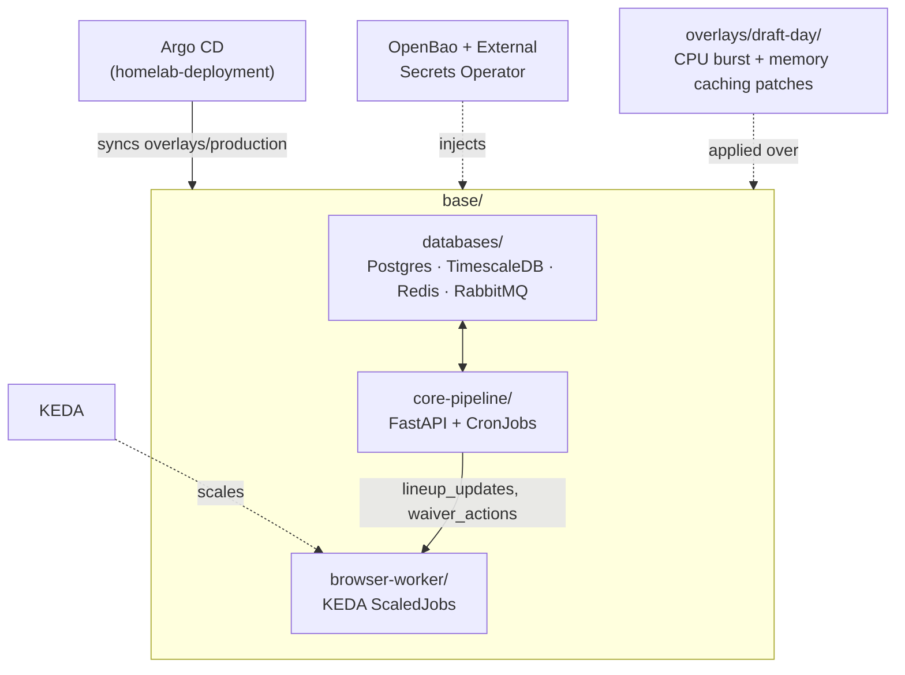

# fantasy-football-infra

This GitOps infrastructure repository manages the Kubernetes deployments, network services, stateful stores, and auto-scaling definitions for the automated fantasy football pipeline.

## Repository Layout

*   `base/`: Core infrastructure configurations agnostic of operational scope.
    *   `databases/`: Manifests for low-memory PostgreSQL/TimescaleDB, Redis, and RabbitMQ. RabbitMQ pre-declares its own queue topology (`lineup_updates`, `waiver_actions`) via a mounted `definitions.json` so the queues exist before any producer/consumer connects — required for the `browser-worker` KEDA triggers below to stay healthy.
    *   `core-pipeline/`: Deployment states for the FastAPI Engine and Weekly CronJobs.
    *   `browser-worker/`: KEDA ScaledJob criteria definitions for Playwright containers.
*   `overlays/`: Environmental delta configurations.
    *   `production/`: Active operational values, sync targets, and `ExternalSecret`s.
    *   `draft-day/`: CPU burst and memory caching patches applied specifically during the live draft window.

Grafana dashboards/datasource for this pipeline live in `homelab-deployment/apps/telemetry/` (that repo's Grafana only provisions dashboards it finds listed in its own Kustomize root) rather than here — see [homelab-deployment#1](https://github.com/cvillarr23/homelab-deployment/issues/1) for the tracked follow-up to make that self-service from repos like this one.

## Cluster Pre-requisites

This repo deploys onto the [`homelab-deployment`](https://github.com/cvillarr23/homelab-deployment) cluster and relies on infrastructure already provisioned there:
1.  **KEDA (Kubernetes Event-driven Autoscaling)**: scales Playwright pods via message metrics.
2.  **StorageClass Configured**: a default local-path or hostpath storage provider to satisfy database PersistentVolumeClaims (PVC).
3.  **OpenBao + External Secrets Operator**: this repo's `Secret`s are materialized via `ExternalSecret` from the shared `openbao` `ClusterSecretStore` — no cleartext credentials are committed here. See `overlays/production/externalsecrets.yaml`.
4.  **Kubernetes 1.27+**: the `core-pipeline/` `CronJob`s set `spec.timeZone` (e.g. `America/Chicago`) so schedules stay correct across DST instead of a hardcoded UTC offset; that field requires 1.27+. (`browser-worker/espn-session-healthcheck-cronjob.yaml` still uses an explicit UTC schedule.)

## Deployment

This repo is registered as an Argo CD `Application` in `homelab-deployment` (`argo-controllers/fantasy-infra.yaml`), pointed at `overlays/production` here. Argo CD syncs automatically on every push — there is no manual `kubectl apply` step for day-to-day changes, consistent with the rest of that cluster.

Before the first sync, populate the secrets this repo expects in OpenBao:

```bash
bao kv put secret/fantasy/postgres postgres-password=<your-choice>
bao kv put secret/fantasy/espn espn_s2=<cookie-value> swid=<cookie-value>
bao kv put secret/fantasy/groq groq_api_key=<key>   # only if the pipeline calls Groq
```

To validate manifests locally without a live cluster:

```bash
kubectl kustomize overlays/production/
kubectl kustomize overlays/draft-day/
```

## Architecture
Cross-repo architecture and reference docs for the whole platform live in [`fantasy-core-pipeline`'s `ARCHITECTURE.md`](https://github.com/cvillarr23/fantasy-core-pipeline/blob/main/ARCHITECTURE.md).

This repo's own layout:



## Project Tracking
Engineering tickets for this repo live as [GitHub Issues](https://github.com/cvillarr23/fantasy-infra/issues) and are tracked on the [Fantasy Manager project board](https://github.com/users/cvillarr23/projects/2), alongside `fantasy-browser-worker` and `fantasy-core-pipeline`.
