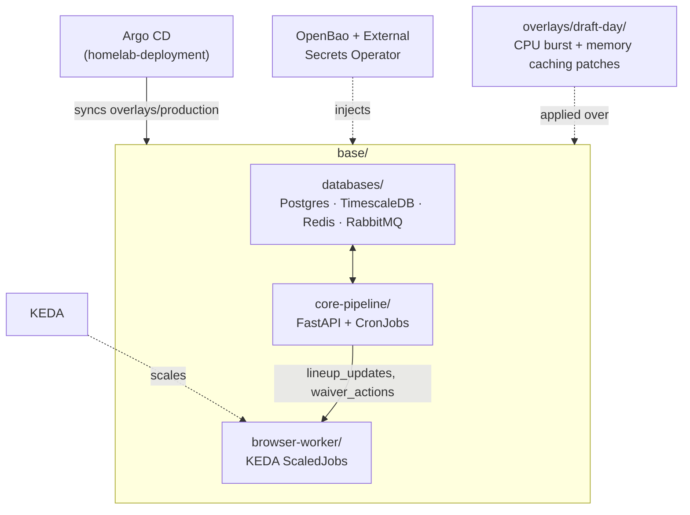
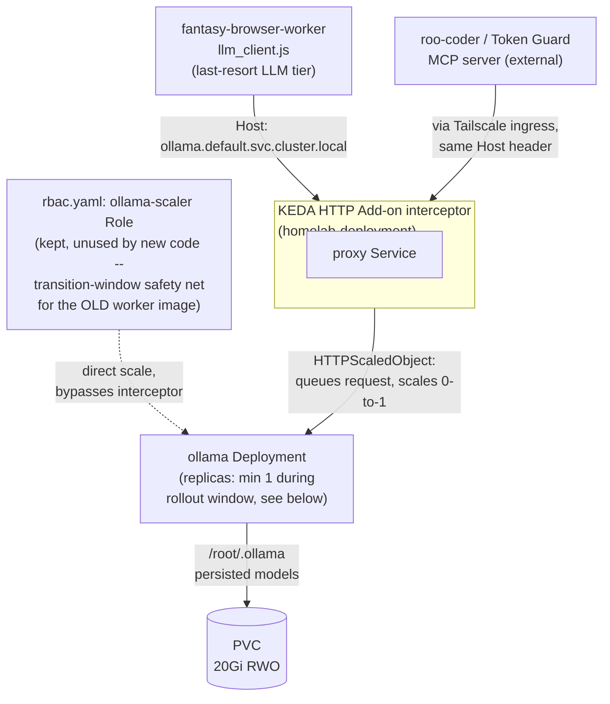

# fantasy-football-infra

This GitOps infrastructure repository manages the Kubernetes deployments, network services, stateful stores, and auto-scaling definitions for the automated fantasy football pipeline.

## Repository Layout

*   `base/`: Core infrastructure configurations agnostic of operational scope.
    *   `databases/`: Manifests for low-memory PostgreSQL/TimescaleDB, Redis, and RabbitMQ. RabbitMQ pre-declares its own queue topology (`lineup_updates`, `waiver_actions`) via a mounted `definitions.json` so the queues exist before any producer/consumer connects — required for the `browser-worker` KEDA triggers below to stay healthy.
    *   `core-pipeline/`: Deployment states for the FastAPI Engine and Weekly CronJobs.
    *   `browser-worker/`: KEDA ScaledJob criteria definitions for Playwright containers.
    *   `ollama/`: Shared, scale-to-zero Ollama deployment — the last-resort LLM tier for `fantasy-browser-worker`'s `llm_client.js`, and the local-RAG generate/embed backend for the external `roo-coder` (Token Guard) MCP server. On-demand scale-up/down is handled by `homelab-deployment`'s KEDA HTTP Add-on interceptor (see the diagram below), not by either consumer directly. Reached from outside the cluster via `tailscale-ingress.yaml`.
*   `overlays/`: Environmental delta configurations.
    *   `production/`: Active operational values, sync targets, and `ExternalSecret`s.
    *   `draft-day/`: CPU burst and memory caching patches applied specifically during the live draft window.

Grafana dashboards and alert rules for this pipeline are registered from this repo. homelab-deployment's Grafana runs sidecars that load ConfigMaps in `default` labeled `grafana_dashboard: "1"` (dashboards, e.g. `base/core-pipeline/*-dashboard.yaml`) or `grafana_alert: "1"` (Grafana alert rules, `base/telemetry/`; see [docs/cronjob-alerts.md](docs/cronjob-alerts.md) for the CronJob alerts runbook and `./tests/cronjob_alerts/run.sh` for their promtool tests). Datasources still live in `homelab-deployment/apps/telemetry/`. This repo's side of that wiring (INFRA-06) is the read-only `grafana_reader` Postgres role, provisioned by a one-shot `Job` in `base/databases/postgres-readonly-role-job.yaml` — Grafana's datasource authenticates as that role, never `bot_admin`.

## Cluster Pre-requisites

This repo deploys onto the [`homelab-deployment`](https://github.com/cvillarr23/homelab-deployment) cluster and relies on infrastructure already provisioned there:
1.  **KEDA (Kubernetes Event-driven Autoscaling)**: scales Playwright pods via message metrics.
2.  **StorageClass Configured**: a default local-path or hostpath storage provider to satisfy database PersistentVolumeClaims (PVC).
3.  **OpenBao + External Secrets Operator**: this repo's `Secret`s are materialized via `ExternalSecret` from the shared `openbao` `ClusterSecretStore` — no cleartext credentials are committed here. See `overlays/production/externalsecrets.yaml`.
4.  **Kubernetes 1.27+**: the `core-pipeline/` `CronJob`s set `spec.timeZone` (e.g. `America/Chicago`) so schedules stay correct across DST instead of a hardcoded UTC offset; that field requires 1.27+. (`browser-worker/espn-session-healthcheck-cronjob.yaml` still uses an explicit UTC schedule.)

## Deployment

This repo is registered as an Argo CD `Application` in `homelab-deployment` (`argo-controllers/fantasy-infra.yaml`), pointed at `overlays/production` here. Argo CD syncs automatically on every push — there is no manual `kubectl apply` step for day-to-day changes, consistent with the rest of that cluster.

Before the first sync, populate the secrets this repo expects in OpenBao:

```bash
bao kv put secret/fantasy/postgres postgres-password=<your-choice>
bao kv put secret/fantasy/postgres-readonly readonly-password=<your-choice>  # grafana_reader role
bao kv put secret/fantasy/espn espn_s2=<cookie-value> swid=<cookie-value>
bao kv put secret/fantasy/groq groq_api_key=<key>   # only if the pipeline calls Groq
```

To validate manifests locally without a live cluster:

```bash
kubectl kustomize overlays/production/
kubectl kustomize overlays/draft-day/
./scripts/preflight-draft-sync-env.sh
```

## Draft Sync Rollout + Smoke Test Runbook

Use this checklist in the PR for any draft-sync env wiring or listener-job changes.

1. **Apply/sync latest manifests**
   ```bash
   # GitOps default: wait for ArgoCD auto-sync, or force immediately:
   argocd app sync fantasy-infra --force

   # Optional local/manual equivalent:
   kubectl apply -k overlays/production/
   ```

2. **Restart and confirm `fantasy-core-pipeline` rollout**
   ```bash
   kubectl rollout restart deployment/fantasy-core-pipeline -n default
   kubectl rollout status deployment/fantasy-core-pipeline -n default
   kubectl get pods -n default -l app=fantasy-core-pipeline
   ```

3. **Smoke test practice sync + draft listener flows**
   ```bash
   kubectl port-forward svc/fantasy-core-pipeline 8000:8000 -n default
   ```
   In a second terminal, run:
   ```bash
   # Practice sync Job creation endpoint
   curl -i -X POST http://localhost:8000/v1/draft/practice/sync-job

   # Draft listener start endpoint
   curl -i -X POST http://localhost:8000/v1/draft/start

   # Stream endpoint returns active job/state updates after start
   curl -i http://localhost:8000/v1/draft/stream
   ```
   Confirm each endpoint returns expected success/status responses (not missing-env errors) and that corresponding draft-sync Jobs are created/updated in-cluster.

## Architecture
Cross-repo architecture and reference docs for the whole platform live in [`fantasy-core-pipeline`'s `ARCHITECTURE.md`](https://github.com/cvillarr23/fantasy-core-pipeline/blob/main/ARCHITECTURE.md).

This repo's own layout:



### Shared Ollama tier: scale-to-zero via KEDA HTTP Add-on

`base/ollama/` is deliberately consumer-agnostic — both in-cluster and Tailscale-only consumers
reach it through the same interceptor by setting the same `Host` header, and neither ever calls
the Kubernetes API to scale it directly:



The `min: 1` on the `HTTPScaledObject` and the otherwise-unused `ollama-scaler` Role in
`rbac.yaml` both exist for the same reason: until `fantasy-browser-worker`'s interceptor-routing
image is confirmed rolled out, an old worker pod could still be scaling Ollama directly via RBAC,
invisible to KEDA's traffic-based scaling. Both are meant to come out together once that rollout
is confirmed.

## Project Tracking
Engineering tickets for this repo live as [GitHub Issues](https://github.com/cvillarr23/fantasy-infra/issues) and are tracked on the [Fantasy Manager project board](https://github.com/users/cvillarr23/projects/2), alongside `fantasy-browser-worker` and `fantasy-core-pipeline`.
