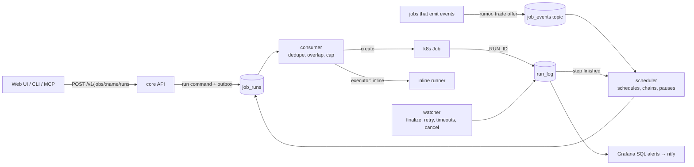
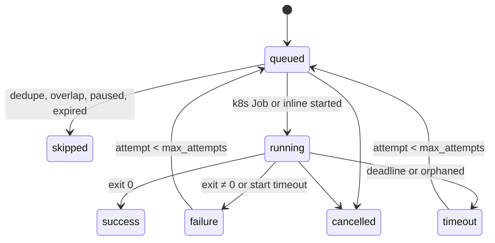

**Status:** Accepted (2026-10-26). Supersedes the draft on branch `infra-76-rabbitmq-launcher-adr`.

:::tip[Decision]
Every job gets one entry point. Schedules, named chains, events, the web UI, the CLI and MCP tools all send the same run command to the `job_runs` queue. One launcher in `fantasy-core-pipeline` turns each command into a k8s Job (or an inline run for tiny jobs) and records it in `run_log`. All 16 CronJobs go away. The KEDA work-item worker stays as it is.
:::

## Why change?

- **No on-demand runs.** A run starts only from a CronJob, `kubectl create job --from=cronjob/...` or the draft endpoints. Lineup, trade and waiver scans can't be run from the UI.
- **Three ways to create Jobs.** CronJobs, manual kubectl and `src/api/draft.py` each create Jobs, and alerting only sees the CronJob-owned ones.
- **Clock offsets instead of dependencies.** The Tuesday sequence (16:00 → 21:45) is spaced by time ([schedule order](../cronjob-schedule-order.md)); nothing stops lineup running on stale projections or waits for a slow step.
- **Per-CronJob alerting.** Every new CronJob needs alert-regex, dashboard and fixture edits ([CronJob alerts](../cronjob-alerts.md)).

## What does it look like?



The scheduler, consumer, watcher and inline runner are one process: `python -m src.launcher` in the core image, one replica, `Recreate` strategy.

## What do the words mean?

| Term | Meaning |
|---|---|
| Job | A catalog definition, such as `lineup-optimizer` |
| Run | One execution of a job; one `run_log` row |
| k8s Job | The Kubernetes object a pod-executor run creates |
| Chain | A named workflow of job steps with dependencies |
| Event | A fact (`rumor.signal_created`) that can start runs |

## Where are jobs defined?

In `base/launcher/catalog.yaml`, published as the ConfigMap `fantasy-job-catalog` and validated by core's pydantic schema (`python -m src.launcher.catalog --check`). Infra CI validates against the JSON schema core exports.

```yaml
version: 1
global: {max_concurrent_pods: 2, max_deadline: 2h, start_timeout: 10m, manual_queue_ttl: 30m}
profiles:
  core:   {image: CORE_IMAGE, secrets: [db, espn, redis, trigger-api]}
  worker: {image: WORKER_IMAGE, serviceAccount: fantasy-browser-worker, volumes: [espn-session-state]}
defaults: {executor: pod, overlap: forbid, max_attempts: 1, deadline: 1h, alert: warning}
jobs:
  lineup-optimizer:
    profile: core
    command: [python, -m, src.optimization.lineup_solver]
    params: {week: int?, dry_run: bool?}   # allowlist for on-demand runs
    max_attempts: 3
    alert: critical
    acts: true                             # UI confirms before running
  rumor-action-trigger:
    profile: core
    command: [python, -m, src.services.rumor_action_service]
    schedules: [{cron: "45 21 * * *", tz: America/Chicago, catch_up: 1h}]
    on_event: [{key: rumor.signal_created, debounce: 30m}]
chains:
  tuesday-weekly:
    schedule: {cron: "0 16 * * 2", tz: America/Chicago, catch_up: 2h, seasons: [regular, playoffs]}
    max_duration: 8h
    steps:
      sync-league: {}
      metrics-extractor:  {after: [{step: sync-league, on: success}]}
      lineup-optimizer:   {after: [{step: projections-refresh, on: finish}], latest: "19:15"}
```

| Field | Rule |
|---|---|
| `overlap` | `forbid` refuses a second concurrent run (409 or `skipped`); `queue` waits |
| `max_attempts` | Launcher-owned retries; k8s `backoffLimit` is always 0. trade-scan, trade-inbox, trade-candidates and draft-prep stay at 1 |
| `catch_up` | A slot missed while the launcher was down still fires if inside this window |
| `seasons` | Slots only fire in the listed season windows |
| `executor` | `pod` (default) or `inline` for tiny, frequent jobs once measured |
| `after.on` | `success` stops the chain on failure; `finish` runs either way. Data steps use `success`, acting steps (lineup, waivers) use `finish` |
| `latest` | A chain step starts by this time even if its parent is still running |

Reserved for v2 (parsed, rejected until implemented): `class: service`, `group`, `fan_out`, `approval`.

## What travels on RabbitMQ?

| Exchange / queue | Carries | Consumer |
|---|---|---|
| `job_runs` (+ `.dlq`, 6h TTL) | Commands: "run this job" | Launcher only |
| `job_events` (topic) | Facts: "this happened" | Launcher, and any future subscriber |
| `lineup_updates`, `waiver_actions`, `trade_*`… | Work items | KEDA worker (unchanged) |

Run command: `{run_id, job, params, trigger, requested_by, dedupe_key, parent_run_id, chain_root_id, event_id, downstream, scheduled_for, attempt, traceparent}`.

| Trigger | `dedupe_key` |
|---|---|
| `schedule` | `job@slot` |
| `chain` | `job@chain_root` |
| `event` | `job@key@debounce_window` |
| `manual`, `cli`, `mcp` | fresh UUID |

The API and scheduler write the `queued` run_log row and an outbox row in one transaction and then publish, reusing core's `_accept_durable` and `activity_runner.py`, so the queue and the table can't drift apart.

:::note[Injury alerts stay direct]
`sync_players` → `waiver_actions` → the waiver sniper is the fast pickup path. It is a work item, not an event, and does not go through the launcher.
:::

## How does a run end?



### What stops a run from hanging?

Every stage has a hard limit, and every limit ends in a `run_log` status. Overlap and cap locks are just rows in `queued` or `running`, so any final status frees them.

| Stage | Limit | Enforced by | Ends as |
|---|---|---|---|
| Waiting in `job_runs` | 6h message TTL | RabbitMQ policy | DLQ alert |
| Queued (cap full) | manual 30m; schedule = `catch_up`; chain = `latest` + 30m | consumer | `skipped (expired)` |
| Pod Pending | 10m | watcher | `failure (start_timeout)`, k8s Job deleted |
| Running | per-job `deadline`, capped at 2h | `activeDeadlineSeconds` + watcher | `timeout` |
| Lost track | deadline + 10m, checked every minute | watcher | `timeout (orphaned)` |
| Inline run | same deadline; SIGTERM, SIGKILL after 30s | inline runner | `timeout` |
| Whole chain | `max_duration` | scheduler | remaining steps `skipped` |
| Finished k8s Jobs | `ttlSecondsAfterFinished` 1 day | Kubernetes | removed |

## How do pods report back?

The launcher creates the `run_log` row and passes `RUN_ID`, `RUN_TRIGGER` and `RUN_PARENT_ID`. The outermost `run_scope` in the pod adopts `RUN_ID` and clears it from the environment, so subprocesses and nested scopes become child rows. `trigger_from_env()` prefers `RUN_TRIGGER` over the CronJob-name heuristic. The worker's `src/db/run_log.js` follows the same rules.

New `run_log` fields: statuses `queued|skipped|cancelled|timeout`; `dedupe_key` (unique), `scheduled_for`, `attempt`, `requested_by`, `chain_root_id`, `event_id`, `end_reason`. New tables: `job_overrides` (pause/snooze) and `launcher_heartbeat` (including `job_runs` depths, since the cluster doesn't scrape RabbitMQ).

## How is it monitored?

Grafana SQL alerts on `run_log` replace every `kube_cronjob_*` rule and route to the existing ntfy contact point:

- launcher heartbeat older than 5 minutes;
- `failure`, `timeout` or `skipped` (excluding paused) on jobs with `alert: warning|critical`;
- `job_runs.dlq` depth above 0;
- a chain run past its `max_duration`.

## How do we get there?

Never open an infra PR that needs new core or worker code until that image is live. Each cutover PR removes its CronJobs and adds the matching catalog entries, alert edits and dashboard edits together.

| Step | Moves |
|---|---|
| Foundation | core run_log, catalog, launcher, scheduler, events, API; infra Deployment, queues, empty catalog, alerts |
| Batch A | rumor-syncer, rapid-status-syncer, stale-draft sweeper, ESPN session check, rumor digest |
| Batch B | the `tuesday-weekly` chain, cut over midweek |
| Batch C | trade-candidates ×2, scores reconcile, trade-scan, trade-inbox; delete remaining CronJob alerts |
| After | web UI Jobs page, rumor and trade-offer events, CLI/MCP, right-sizing |

**v2** (designed, not built): draft Jobs under the launcher (before the August draft), approval steps in chains, fan-out steps, KEDA worker under the launcher, concurrency groups, per-run resource accounting, launcher HA, Helm packaging.

## What else was considered?

| Option | Why not |
|---|---|
| Keep CronJobs, add a run-now endpoint | Leaves three ways to create Jobs and per-CronJob alerting |
| Airflow, Prefect | Scheduler, UI and metadata DB cost 0.5–3 Gi on a single node already at 81% memory; Node bots fit poorly |
| Argo Workflows | Closest fit (k8s-native DAGs, UI), but needs Argo Events and an EventBus to start from RabbitMQ. Revisit at v2 fan-out; `after:` mirrors Argo's `dependencies:` |
| Postgres as the run queue | Fewer parts, but RabbitMQ keeps commands and events on the same shared bus other services can subscribe to |
| Replace KEDA | KEDA stays for ollama regardless; replacing the ScaledJob saves no overhead and risks the draft-pick path |

## Consequences

- The launcher is a single point of failure for scheduled work. Catch-up windows cover restarts, and the heartbeat alert covers outages.
- It adds one small always-on pod (about 50m / 128Mi). Moving the frequent syncers inline after measuring pays that back.
- `scripts/generate-schedules.py` reads the catalog and generates the schedule table and chain diagrams.

## Related

- [Schedules](../schedules.md) · [Schedule order](../cronjob-schedule-order.md) · [RabbitMQ queue rollout](../rabbitmq-queue-rollout.md)
- [How bots run](/worker/how-bots-run) · [Queue publishing](/core/queue-publishing)
