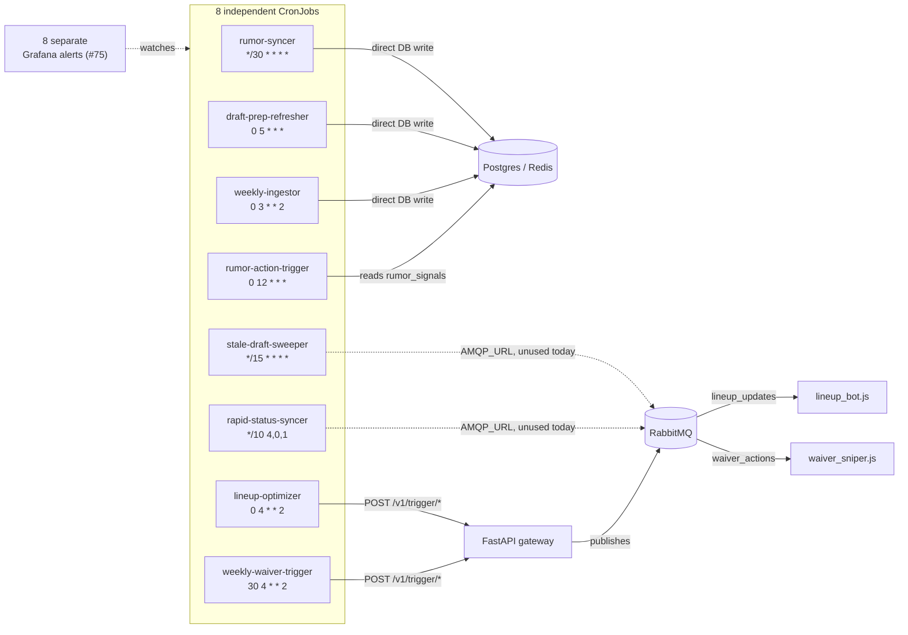
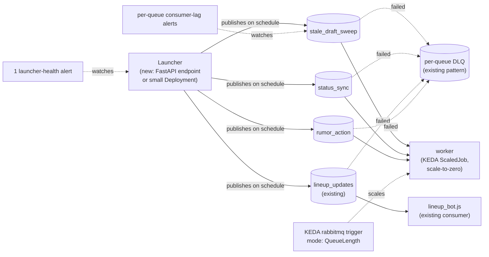
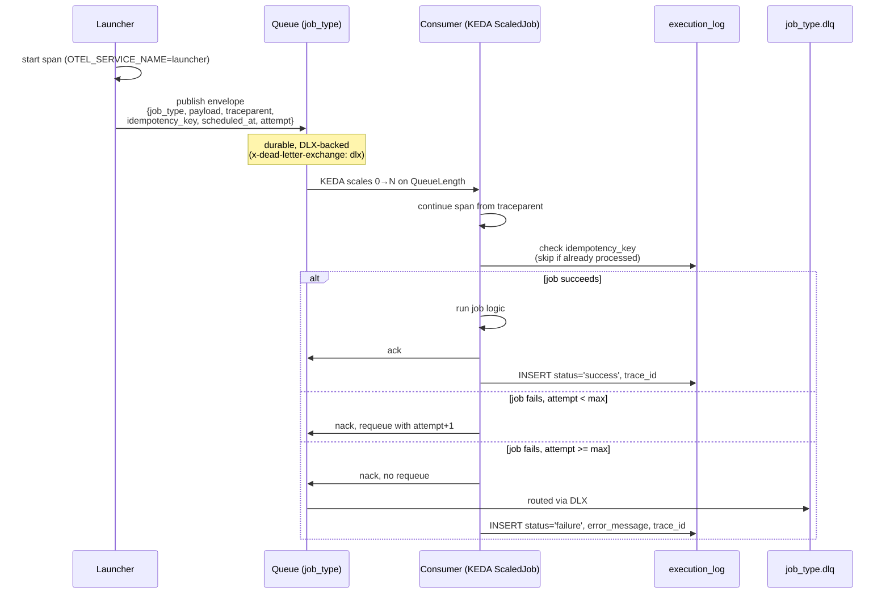

# ADR 0001: Unified RabbitMQ Launcher for Cron-Triggered Work

## Status

Proposed

## Context

`base/core-pipeline/` currently defines 8 separate `batch/v1` CronJobs, each independently scheduling a piece of pipeline work:

| CronJob | Schedule | Mechanism |
|---|---|---|
| `fantasy-rumor-syncer` | `*/30 * * * *` | `python -m src.ingestion.sync_rumors` — pure ingestion, no queue involvement |
| `fantasy-draft-prep-refresher` | `0 5 * * *` | initContainer `sync_projections` → main `vorp_matrix` (two-phase, ordered) |
| `fantasy-weekly-ingestor` | `0 3 * * 2` | initContainer `sync_league --season 2026` → main `metrics_extractor` (two-phase, ordered) |
| `fantasy-lineup-optimizer` | `0 4 * * 2` | `lineup_solver` POSTs to FastAPI `/v1/trigger/*`, which publishes onto the `lineup_updates` queue consumed by `lineup_bot.js` |
| `fantasy-weekly-waiver-trigger` | `30 4 * * 2` | shell wrapper resolves the current week, then runs `waiver_evaluator`, feeding `waiver_sniper.js` via `waiver_actions` |
| `fantasy-stale-draft-job-sweeper` | `*/15 * * * *` | `sweep_stale_draft_jobs`; already carries `AMQP_URL` |
| `fantasy-rapid-status-syncer` | `*/10 * * * 4,0,1` | `sync_players`; already carries `AMQP_URL` |
| `fantasy-rumor-action-trigger` | `0 12 * * *` | `rumor_action_service`, acts on `rumor_signals` rows written by `rumor-digest-bot` |

Each CronJob needs its own Grafana "did this run" alert (tracked separately in #75) to catch a missed or failed execution — 8 independent surfaces to monitor, each with its own `restartPolicy`/`backoffLimit` retry semantics.

RabbitMQ + KEDA scale-to-zero consumption already exists and is proven: `base/databases/rabbitmq-deployment.yaml` pre-declares durable queues (`lineup_updates`, `waiver_actions`, `draft_targets`), each paired with a DLX/DLQ for failed messages (`x-dead-letter-exchange: dlx` routing to a per-queue `<name>.dlq`), and `base/browser-worker/keda-scaledjob.yaml` scales a `ScaledJob` from zero based on `QueueLength` on those same queues. Queues must be pre-declared by the broker itself, since KEDA's rabbitmq scaler errors (rather than reporting zero) against a queue that doesn't exist yet and no scaled-to-zero consumer is running to create it.

Two more conventions already exist and matter for the loop design in this ADR:

- **`execution_log` Postgres table** (read by `fantasy-execution-log-grafana-dashboard`) — every bot/job writes a row with `bot_name`, `status` (`success`/`failure`), `error_message`, `trace_id`, `executed_at`. This is the existing, generic "did this run and how did it go" surface — the rumor-digest/rumor-action failure alerts already point at it.
- **OTEL span propagation** — `OTEL_SERVICE_NAME` is already wired into `fastapi-deployment.yaml`, the CronJobs, and `keda-scaledjob.yaml`, exporting to Tempo (see `fantasy-traces-dashboard.yaml`). A queue-based loop should carry trace context through the message so a launcher's publish span and a consumer's processing span link into one trace instead of two orphaned ones.

`fantasy-infra` is manifests-only: none of the actual job logic (`sync_rumors`, `vorp_matrix`, `waiver_evaluator`, `sweep_stale_draft_jobs`, etc.) lives here — it's all in the sibling `fantasy-core-pipeline` (Python) repo, with consumer bots (`lineup_bot.js`, `waiver_sniper.js`) in `fantasy-browser-worker` (JS). A unified launcher needs new scheduler code and adapted/new consumer code in those repos; this ADR evaluates the shape of that work without implementing it there.

*Fig. 1 — today, three paths reach RabbitMQ: two jobs already carry unused `AMQP_URL` credentials, two go through the FastAPI trigger gateway, and the rest write straight to Postgres/Redis with no queue at all. Each CronJob needs its own liveness alert.*

## Decision

Recommend a **phased pilot**, not a wholesale migration, starting with the jobs that already touch RabbitMQ.

### Migration fit, by job

**Good fit** — already RabbitMQ-adjacent or naturally event-shaped, smallest consumer-side lift:
- `fantasy-stale-draft-job-sweeper` (already carries `AMQP_URL`)
- `fantasy-rapid-status-syncer` (already carries `AMQP_URL`)
- `fantasy-lineup-optimizer` (already ends in a queue publish downstream)
- `fantasy-rumor-action-trigger` (single-step, acts on rows written by another job)

**Needs care** — two-phase execution via `initContainer` ordering. A launcher would need to either publish two chained messages (phase-1 message triggers a consumer that, on success, publishes phase-2) or have a single consumer run both steps in sequence, which reproduces the current CronJob's ordering guarantee inside a worker instead of a manifest:
- `fantasy-draft-prep-refresher` (`sync_projections` → `vorp_matrix`)
- `fantasy-weekly-ingestor` (`sync_league` → `metrics_extractor`)
- `fantasy-weekly-waiver-trigger` (week resolution → `waiver_evaluator`)

**Questionable fit** — pure scheduled ingestion with no natural "worker reacts to an event" shape. A scheduler firing a message onto a queue vs. a CronJob directly invoking the script is a wash in complexity, with no observability or retry benefit gained:
- `fantasy-rumor-syncer`

Recommendation: do not migrate `fantasy-rumor-syncer` at all under this proposal — it stays a plain CronJob.

### Target architecture (for the pilot batch only)

- One lightweight in-cluster scheduler process — either a new endpoint on the existing `fastapi-deployment` or a small standalone Deployment — replaces the pilot batch's 4 CronJobs. On each job's schedule, it publishes a message onto a dedicated, pre-declared durable queue (following the existing `lineup_updates`/`waiver_actions`/`draft_targets` pattern: one queue per job type, each paired with a DLX/DLQ).
- Consumers are adapted or new workers in `fantasy-core-pipeline`/`fantasy-browser-worker`, scaled via a KEDA `ScaledJob` `rabbitmq` trigger with `mode: QueueLength`, mirroring `base/browser-worker/keda-scaledjob.yaml`. Scale-to-zero stays the default; `overlays/draft-day` can still force a warm minimum the same way it already does for the browser worker.
- This consumer/scheduler code is out of scope for `fantasy-infra` and is not implemented as part of this ADR — see Follow-ups.

*Fig. 2 — the pilot batch collapses to one scheduler and four durable queues, each paired with the existing DLQ pattern from `rabbitmq-deployment.yaml`. Consumers scale from zero the same way `browser-worker` already does.*

### Request / Receive / Notify contract (generalized for future jobs)

The pilot only migrates 4 jobs, but the loop below is designed so **any future scheduled job** — including the "needs care" and "questionable fit" jobs above, if they migrate later — can adopt it without a new bespoke contract. Onboarding a new job type is: declare a `<job_type>` queue + `.dlq` pair in `rabbitmq-deployment.yaml`, point a consumer (existing or new `ScaledJob`) at it, and have the launcher publish the envelope below on schedule. No new alerting, dashboard, or callback mechanism is invented per job — everything reuses `execution_log` and the existing DLX pattern.

*Fig. 3 — the generic loop every job type follows. "Notify" is not a new callback: success/failure both land in the existing `execution_log` table (already dashboarded), and repeated failure is visible as DLQ depth (existing per-queue DLX pattern) — so a single templated Grafana alert on DLQ depth generalizes across every current and future job type instead of #75's one-alert-per-CronJob.*

**Envelope fields:**

| Field | Purpose |
|---|---|
| `job_type` | Routing key / identifies which queue and which consumer logic handles this message |
| `payload` | Job-specific arguments (e.g. `team_id`, `season`, `week`) |
| `traceparent` | W3C trace context, so the consumer's span links to the launcher's publish span in Tempo |
| `idempotency_key` | Dedupe key (e.g. `job_type:scheduled_at`) so redelivery after a crash or requeue doesn't double-run the job |
| `scheduled_at` | When the launcher intended this to fire — lets a consumer or dashboard detect late delivery |
| `attempt` | Retry count; consumer increments on nack/requeue up to a max before letting the message fall through to the DLQ |

Two-phase jobs (the "needs care" bucket) fit this same envelope as either two chained messages (a phase-1 consumer publishes the phase-2 envelope on success, carrying the same `traceparent`) or a single consumer running both steps — a decision left to the follow-up implementation issue, not this ADR, since it doesn't change the contract shape above.

## Consequences

- Collapses the pilot batch's 4 per-cron Grafana alerts (#75) into one launcher-health alert plus a single templated DLQ-depth alert that generalizes across every job type, current or future — fewer, more meaningful signals instead of one alert per CronJob.
- Retry becomes centralized via the existing DLQ pattern instead of each CronJob's own `restartPolicy`/`backoffLimit`, and success/failure both land in the existing `execution_log` table — no new notify mechanism to build or maintain per job.
- Loses the current CronJob property that one manifest fully describes one job's lifecycle end-to-end; failure diagnosis now spans a scheduler, a queue, and a separate worker repo (mitigated by `traceparent` propagation linking the two spans in Tempo).
- The "needs care" batch (two-phase jobs) gains real complexity if migrated later — ordering has to be reconstructed either as chained messages or as a single fatter consumer step. The envelope contract already accommodates this (see Request/Receive/Notify contract above), but this ADR does not recommend migrating them yet.
- `fantasy-rumor-syncer` sees no benefit from migration and should stay as-is.
- Because the envelope/notify contract is generic, onboarding a future job type is a queue+DLQ declaration and a consumer, not a new bespoke integration — this is the main argument for designing the contract now even though only 4 jobs migrate in the pilot.

## Alternatives considered

- **Migrate all 8 at once**: rejected — the two-phase jobs would need ordering logic invented from scratch under time pressure, and `rumor-syncer` gains nothing from the change; the blast radius doesn't match the issue's own `priority/low` framing.
- **Keep all 8 CronJobs, rely solely on #75's per-cron alerts**: valid fallback if the pilot doesn't show a clear win; #75 already solves the immediate "did this run" visibility gap independent of this migration.

## Follow-ups

Not filed as part of this ADR (cross-repo, and this repo has no way to track work in sibling repos' issue trackers automatically):
- `fantasy-core-pipeline`: build the scheduler/launcher that publishes the pilot batch's 4 job messages onto RabbitMQ.
- `fantasy-core-pipeline` / `fantasy-browser-worker`: adapt or add consumers for the pilot batch's 4 jobs, plus the matching KEDA `ScaledJob` + queue/DLQ manifests in `fantasy-infra` once consumer code exists.
