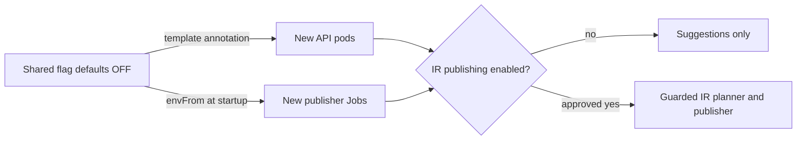

Use this page to confirm unattended IR publication is off, to enable it after approval, and to roll it back.

## How is the flag wired?

`overlays/production/configmap-env.yaml` owns the shared `fantasy-league-config.data.AUTO_PUBLISH_IR_MOVES` key, explicitly set to `"false"`. Three workloads import it through their existing `envFrom` references:

| Workload | Kind |
|---|---|
| `fantasy-weekly-waiver-trigger` | Weekly waiver CronJob |
| `fantasy-rumor-action-trigger` | Rumor-action CronJob |
| `fantasy-core-pipeline` | FastAPI Deployment |

Other consumers of this ConfigMap inherit the key but don't read the flag. The draft-day overlay inherits the same OFF value; it isn't a separate environment switch.



### How core reads it

- Core reads the flag per call, strips whitespace and lowercases it.
- Only `1`, `true` or `yes` enable unattended IR stashes.
- The weekly evaluator and the rumor-action service (CLI and in-process HTTP route) share the guarded planner and publisher.
- With the flag off, IR stashes remain suggestions. Ordinary waiver swaps keep their existing publication behavior.

### Dependency hold

Leave `ACTIVITY_DEPENDENCY_HOLD_SECONDS` unset to use core's 3600-second default. This setting is parsed at module import, not per call.

FastAPI's activity service sets the held add-only claim's deadline when it creates the claim. Its background runner releases the claim only after the parent IR move is verified on ESPN, and cancels it after expiry or terminal parent failure. Verification normally takes minutes, so nothing suggests a different deadline.

## Enable only after live-week approval

1. Obtain explicit approval for the live IR week before proposing an enabling change.
2. Change only `AUTO_PUBLISH_IR_MOVES` in the shared ConfigMap and review the rendered overlays.
3. Update the safety test's expected value in the same separately approved PR.
4. The user merges the reviewed PR, and Argo CD auto-sync deploys it.

:::warning[No separate enabled overlay]
Don't add an enabled overlay as part of the OFF wiring. This procedure needs no cluster mutation commands or manually triggered waiver run.
:::

The production kustomization copies the shared flag into the Deployment's `spec.template.metadata.annotations["fantasy-infra/auto-publish-ir-moves"]`. That changes the pod template and triggers a gateway rollout through Argo CD, because updating a ConfigMap alone doesn't refresh a container's environment.

| Pod type | When it sees the new value |
|---|---|
| Gateway (Deployment) | After the rollout the annotation triggers. |
| New CronJob pods | At start. |
| Existing CronJob pods | Never. They keep their original environment until they exit. |

## Roll back

1. Change the same shared key back to `"false"` through a reviewed GitOps PR.
2. Restore the safety test's OFF expectation.
3. The gateway rolls again, and new CronJob pods load OFF.
4. Inspect any older active publisher pods. Their process environments don't change during a ConfigMap update.

:::warning[Rollback limits]
Disabling the flag doesn't cancel previously queued actions or reverse moves already made on ESPN. Any intervention in active work requires separate explicit approval.
:::

## Validate locally

```sh
kubectl kustomize overlays/production/
kubectl kustomize overlays/draft-day/
python3 -m unittest discover -s tests -p 'test_*.py'
./scripts/preflight-draft-sync-env.sh
git diff --check
```

These kustomize commands render locally without contacting the cluster. Alerts are unchanged, so this change doesn't need promtool validation.

## Read-only post-deploy checks

```sh
kubectl get configmap fantasy-league-config -n default -o yaml
kubectl get cronjob fantasy-weekly-waiver-trigger fantasy-rumor-action-trigger -n default -o yaml
kubectl get deployment fantasy-core-pipeline -n default -o yaml
kubectl get replicasets -n default -l app=fantasy-core-pipeline -o yaml
kubectl get pods -n default -l app=fantasy-core-pipeline -o yaml
```

| Check | Expected |
|---|---|
| ConfigMap key | The string `"false"`. |
| Gateway and both CronJob container templates | Import only `fantasy-league-config` via `envFrom`, with no explicit flag override. |
| Deployment template annotation | `"false"`. |
| Deployment rollout | Observed generation matches generation, and all desired replicas are updated and available. |
| Gateway pods | Belong to the current ReplicaSet, carry that annotation and started after the ConfigMap change (use the Argo CD sync time or ConfigMap managed-fields update time). |
| Existing weekly-waiver and rumor-action pods | Check for stale creation times and overrides. Check their owning Jobs with `kubectl get jobs` if necessary. |

If a scheduled run has occurred, use `kubectl logs -n default <publisher-pod> -c <container>`. IR candidates should be logged as suggestions rather than as published IR moves.

:::note[Evidence limits]
Absence of those messages alone isn't proof, since a run may have no IR candidates. Kubernetes `get` and `logs` can't read process environment values directly, so the template, current ConfigMap and fresh pod lifecycle provide the configuration evidence. Don't trigger a publisher to test the flag.
:::
