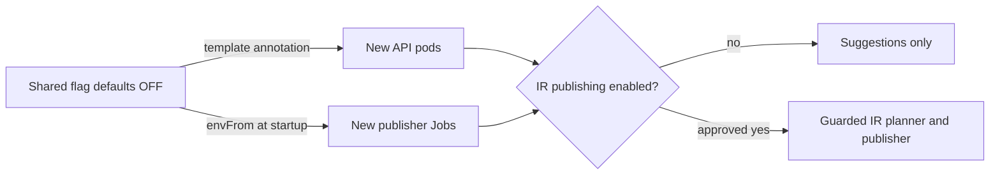

`overlays/production/configmap-env.yaml` owns the shared
`fantasy-league-config.data.AUTO_PUBLISH_IR_MOVES` key, explicitly set to `"false"`.
The weekly waiver CronJob (`fantasy-weekly-waiver-trigger`), rumor-action CronJob
(`fantasy-rumor-action-trigger`), and FastAPI Deployment (`fantasy-core-pipeline`)
all import it through their existing `envFrom` references. Other consumers of this
ConfigMap inherit the key but do not read the flag. The draft-day overlay inherits
the same OFF value; it is not a separate environment switch.

Core reads the flag per call, strips whitespace and lowercases it. Only `1`,
`true`, or `yes` enable unattended IR stashes. The weekly evaluator and the
rumor-action service (CLI and in-process HTTP route) share the guarded planner
and publisher. With the flag off, IR stashes remain suggestions. Ordinary
waiver swaps retain their existing publication behavior.

Leave `ACTIVITY_DEPENDENCY_HOLD_SECONDS` unset to use core's 3600-second default.
FastAPI's activity service sets the held add-only claim's deadline when it is
created; its background runner releases it only after the parent IR move is
verified on ESPN, and cancels it after expiry or terminal parent failure.
Verification normally takes minutes, so there is no evidence requiring a
different deadline. This setting is parsed at module import, not per call.



## Enable only after live-week approval

Obtain explicit approval for the live IR week before proposing an enabling
change. Change only `AUTO_PUBLISH_IR_MOVES` in the shared ConfigMap, review the
rendered overlays, and update the safety test's expected value in that separately
approved PR. Do not add an enabled overlay as part of the OFF wiring.

The production kustomization copies the shared flag into the Deployment's
`spec.template.metadata.annotations["fantasy-infra/auto-publish-ir-moves"]`.
This changes the pod template and triggers a gateway rollout through Argo CD,
because updating a ConfigMap alone does not refresh a container's environment.
New CronJob pods load the current ConfigMap value when they start. Existing
CronJob pods retain their original environment until they exit.

The user merges the reviewed PR. Argo CD auto-sync deploys it; this procedure
does not require cluster mutation commands or a manually triggered waiver run.

## Roll back

Change the same shared key back to `"false"` through a reviewed GitOps PR and
restore the safety test's OFF expectation. The gateway rolls again, and new
CronJob pods load OFF. Inspect any older active publisher pods: their process
environments do not change during a ConfigMap update. Disabling the flag does
not cancel previously queued actions or reverse moves already made on ESPN.
Any intervention in active work requires separate explicit approval.

## Validate locally

```sh
kubectl kustomize overlays/production/
kubectl kustomize overlays/draft-day/
python3 -m unittest discover -s tests -p 'test_*.py'
./scripts/preflight-draft-sync-env.sh
git diff --check
```

These kustomize commands render locally without contacting the cluster. Alerts
are unchanged, so this change does not require promtool validation.

## Read-only post-deploy checks

```sh
kubectl get configmap fantasy-league-config -n default -o yaml
kubectl get cronjob fantasy-weekly-waiver-trigger fantasy-rumor-action-trigger -n default -o yaml
kubectl get deployment fantasy-core-pipeline -n default -o yaml
kubectl get replicasets -n default -l app=fantasy-core-pipeline -o yaml
kubectl get pods -n default -l app=fantasy-core-pipeline -o yaml
```

Confirm the ConfigMap key is the string `"false"`. Check the gateway and both
CronJob container templates import only `fantasy-league-config` via `envFrom`
and have no explicit flag override. Check the Deployment template annotation
is `"false"`, its observed generation matches its generation, and all desired
replicas are updated and available. Verify gateway pods belong to the current
ReplicaSet, carry that annotation, and started after the ConfigMap change
(use the Argo CD sync time or ConfigMap managed-fields update time).
Inspect existing weekly-waiver and rumor-action pods for stale creation times
and overrides; check their owning Jobs if necessary with `kubectl get jobs`.

Use `kubectl logs -n default <publisher-pod> -c <container>` if a scheduled run
has occurred. IR candidates should be logged as suggestions rather than as
published IR moves. Absence of these messages alone is not proof: a run may
have no IR candidates. Kubernetes `get` and `logs` cannot directly read process
environment values; the template, current ConfigMap and fresh pod lifecycle
provide configuration evidence. Do not trigger a publisher to test the flag.
