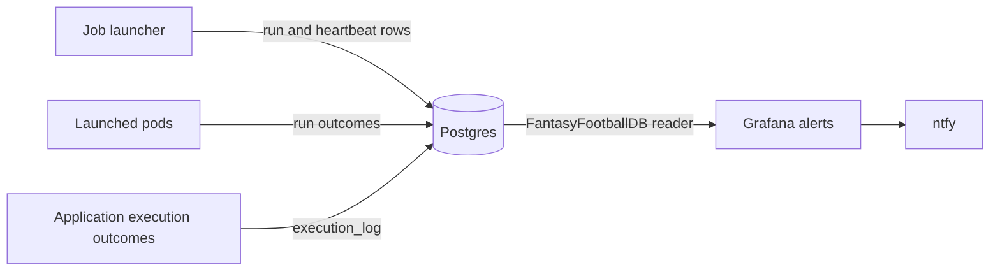

Every scheduled job runs from the [unified job launcher](adr/0001-unified-job-launcher.md), which replaced the CronJobs. Job alerts read Postgres, not kube-state-metrics. Use this page to triage an alert, find what a job depends on and run read-only checks.

Rules live in `base/telemetry/` as ConfigMaps labeled `grafana_alert: "1"`. homelab-deployment's Grafana alert sidecar loads them into the **Fantasy** folder. They query `run_log` and `launcher_heartbeat` through the `FantasyFootballDB` datasource and route to the ntfy contact point. They read columns (`status`, `job_name`, `end_reason`, `attempt`, `chain_root_id`, `finished_at`), never keys inside `run_log.trigger`.



## Which alert fired?

Schedule fields, not comments that assume UTC, determine local run times. The generated [schedule inventory](schedules.md) lists every job, command and timezone.

| Alert | Fires when | First check |
|---|---|---|
| Job launcher heartbeat stale | `launcher_heartbeat.at` is older than 5m, or there is no row | [Heartbeat stale](#launcher-heartbeat-stale) |
| Job launcher dead-letter queue not empty | `queue_depths->>'job_runs.dlq'` is above 0 | [DLQ not empty](#launcher-dlq-not-empty) |
| Job launcher cannot read its queues | The heartbeat is fresh but `job_runs` or its DLQ depth is null, for 2m | [Queue depth unknown](#launcher-queue-depth-unknown) |
| Job launcher job_runs backlog | `job_runs` depth stays above 0 for 15m | [Backlog](#launcher-job-runs-backlog) |
| Launcher run failed (critical / warning jobs) | A job at that `alert` level had a run end `failure` or `timeout` on its last attempt, or `skipped` for a reason that needs a person, in the last 10m. One series per job | [Run failed](#launcher-run-failed) |
| Job launcher chain ran past max_duration | A chain root ended `timeout` with `end_reason = 'max_duration'` in the last 10m | [Chain past max_duration](#launcher-chain-past-max-duration) |
| Rumor action incomplete or failed processing | A `failure` or `partial_failure` was recorded in the last 26h | [Application outcome](cronjob-application-outcomes.md#rumor-action-application-outcome) |

### What covers a missed or hung run?

There is no per-job missed-schedule rule.

| Situation | What you see |
|---|---|
| The launcher is down | The heartbeat alert. Once it's back, a slot still inside its `catch_up` window fires late |
| A scheduled slot can't start inside its `catch_up` window because the pod cap is full | `skipped (expired)`, reported by the run-failed rule |
| An event run finds its job busy or can't start in time | No alert, by design: the next event or the job's scheduled slot covers it. Under `overlap: queue` (`rumor-action-trigger`) it waits for the busy run instead of skipping `overlap`, and ends `skipped (expired)` only if it can't start within its debounce window |
| The launcher was down for longer than a slot's window | The slot never fires and leaves no `run_log` row. Compare `run_log` with the [schedule inventory](schedules.md) after an outage |
| A run hangs | It ends `timeout` at its `deadline`, reported by the run-failed rule on the last attempt |
| A run succeeds but did nothing useful | No alert. Check the job's logs and [application outcomes](cronjob-application-outcomes.md) |

## Launcher alerts

### Launcher heartbeat stale

The launcher writes the row every 15s on its own thread, so a stale row means the process is down or stalled, or the database is unreachable from it. Nothing scheduled or on-demand starts meanwhile; catch-up windows cover short outages.

```bash
kubectl get deploy,pod -l app=fantasy-job-launcher -n default
kubectl logs deploy/fantasy-job-launcher -n default --tail=100
```

A launcher that refuses to start logs `Job catalog is not usable`; fix the catalog or the env it names.

### Launcher DLQ not empty

`job_runs.dlq` holds run commands the broker dead-lettered, such as a message that waited past the 6h TTL while the launcher was down. Inspect without consuming:

```bash
kubectl exec -n default deploy/fantasy-broker -c rabbitmq -- \
  rabbitmqctl list_queues -p / name messages_ready messages_unacknowledged
```

Decide with the owner whether each run is still wanted before replaying or purging; don't purge to silence the alert.

### Launcher queue depth unknown

The heartbeat is arriving but the launcher couldn't read a queue's depth: `job_runs` or `job_runs.dlq` is missing (the broker definitions didn't load) or the broker is unreachable from the launcher. It can't consume either way. Check `rabbitmqctl list_queues` as above and the launcher log for `Launcher queue depths unavailable`.

### Launcher job_runs backlog

`job_runs` has had messages for 15 minutes, though the launcher takes them promptly. The heartbeat thread is alive but the consumer is stalled or blocked. Check the launcher log and `run_log` rows stuck in `queued`.

### Launcher run failed

These rules are generated from `base/launcher/catalog.yaml`, because `run_log` doesn't record a job's `alert` level: the critical and warning rules each list the job names and `max_attempts` at that level, and an empty catalog matches nothing. Jobs with `alert: none` never alert. After editing the catalog, run `python3 scripts/generate-launcher-alerts.py` and commit the result; CI fails on a stale rule.

Each rule returns one series per job, so the page names the job, and carries a `severity` label (`critical` or `warning`) to route on. A failure or timeout alerts only on a job's last attempt (`attempt >= max_attempts`), or when a chain step's root has already ended, since the watcher can no longer retry it. Skips with `end_reason` `paused`, `chain_step`, `max_duration` or `chain_ended` are excluded: a chain timeout alerts once, on the chain rule. Event-triggered runs (`trigger_type = 'event'`) also drop `overlap` and `expired` skips: an event is a speed-up over the job's schedule, so one that finds the job busy or can't start in time is routine, and the next event or scheduled slot covers it. Schedule and chain skips keep alerting. To inspect a run, query `run_log` by `job_name` and `finished_at`, then see `summary.log_tail`.

```bash
kubectl get jobs -n default -l fantasy.job=<job> --sort-by=.metadata.creationTimestamp
kubectl logs -n default -l fantasy.job=<job> --tail=200
```

A `skipped` run with `end_reason` `overlap` means the previous run, or its retry, was still running at the next slot. `expired` means the run couldn't start inside its schedule's `catch_up` window, a chain step couldn't start within 30 minutes of its `latest` time, or an event run couldn't start within its debounce window (event runs' `expired` doesn't alert). `dependency_failed` means a chain step's `on: success` parent didn't succeed; fix that parent first, since the skip is only its consequence.

#### What each job depends on

| Job | Check first |
|---|---|
| `sync-league` | First `tuesday-weekly` step. ESPN cookies (`espn-session-secrets` `espn_s2`/`swid`), league configuration, Postgres. If it fails, `metrics-extractor` and `sync-actual-scores` are skipped (`dependency_failed`) and the rest of the chain still runs. |
| `metrics-extractor` | Runs after `sync-league` succeeds. External play-by-play source and Postgres. It refreshes historical metrics; it doesn't replace the projection/VORP refresh. |
| `sync-actual-scores` | Runs after `metrics-extractor` succeeds, and on its own Friday at 10:00 to reconcile. ESPN cookies (`espn-session-secrets` `espn_s2`/`swid`) and `ESPN_LEAGUE_ID`, the public NFL scoreboard, Postgres, and Redis for read-cache invalidation. See [score sync failures](#score-sync-failures). |
| `projections-refresh` | Runs daily at 18:00 and in the chain once `sync-actual-scores` finishes. Sleeper skill-position projections, ESPN K/D-ST projections (needs `espn-session-secrets` `espn_s2`/`swid`), then VORP for each horizon week. Check season/week/team configuration and Postgres credentials. It supplies target-week VORP for lineup and waiver decisions and later-week VORP for trade scoring. Its stages are child runs in `run_log`. See the [refresh horizon](cronjob-schedule-order.md#projection-and-vorp-refresh-horizon). |
| `lineup-optimizer` | Critical. Runs once the refresh finishes, or at 19:15 at the latest. Roster/weekly-stat rows, target-week VORP and prior-week fallback, Postgres, core API, trigger API key and downstream lineup processing. Zero swaps is success: its dashboard log panel distinguishes `Lineup already optimal` from `Published N lineup swap(s)`. Missing input fails the run after [core-pipeline#178](https://github.com/cvillarr23/fantasy-core-pipeline/issues/178). |
| `waiver-trigger` | Critical. Runs once lineup finishes, or at 20:30 at the latest. Exact-week bench/free-agent pools from the refresh, Postgres, core API and trigger API key, downstream RabbitMQ/browser-worker claims. It has no prior-week fallback; empty pools fail the run after [core-pipeline#181](https://github.com/cvillarr23/fantasy-core-pipeline/issues/181). |
| `rumor-action-trigger` | Runs daily at 21:45, in the chain once waivers finish, and within minutes of each digest on `rumor.signal_created` (one run per 30-minute window). Under `overlap: queue`, the slot and the chain step wait for an event run still in flight. Rumor sync and today's 11:00 digest, rumor-signals rows, team/season config, Postgres, Redis, core API and downstream action processing. A successful run isn't proof of complete application processing; see [application outcome](cronjob-application-outcomes.md#rumor-action-application-outcome). |
| `espn-session-healthcheck` | ESPN reachability and `espn-session-secrets` (`espn_s2`/`swid`), league configuration, Postgres execution logging. Cookies require human refresh when expired. |
| `rapid-status-syncer` | Player-status source, Postgres, Redis and RabbitMQ credentials/connectivity. Thu/Sun/Mon are the only scheduled days. |
| `rumor-digest-bot` | Rumor inputs in Postgres, database/execution-log credentials and the Groq/Gemini LLM fallback credentials. No ESPN cookies or browser required. It runs at 11:00 and emits `rumor.signal_created` for each stored signal through the `amqp` bundle, which starts `rumor-action-trigger`. Signals that need fresh VORP wait for the 21:45 run. |
| `rumor-syncer` | External rumor sources, ingestion logs, Postgres and Redis. Ingestion feeds the digest/action path. |
| `stale-draft-job-sweeper` | `fantasy-core-pipeline` service account (the `core-ops` profile) and draft-sync-orchestrator RBAC for listing/deleting Jobs, Postgres, RabbitMQ, Redis and core API teardown. Verification only reads these resources. |
| `trade-candidates` | Daily at 07:00, Wednesday/Friday at 12:30. Core API startup migrations must create the candidate tables first. Needs league/team/season configuration, week resolution, trade context and refreshed projection/VORP inputs, Postgres and ESPN session secrets. An unresolved week or unavailable context fails the run. Check the stored run's freshness before the scan; see [rollout and verification](cronjob-schedule-order.md#trade-candidate-rollout-and-verification). One attempt. |
| `trade-scan` | Wednesday/Friday at 13:00. ESPN stored session/cookies, Groq/Gemini LLM credentials, league/team configuration, Postgres claims and core trade routes. One attempt: inspect `trade_scan` logs and `execution_log` claims before any recovery; see [outgoing trade scan](cronjob-application-outcomes.md#outgoing-trade-scan). |
| `trade-inbox` | Every two hours, 08:00 through 22:00. ESPN stored session/cookies, league/team configuration, Postgres inbox/execution logging, and core `POST /v1/trade/score`. No LLM keys. A successful run can still contain unavailable or stale scores; inspect refresh logs and score outcomes. One attempt. |

#### Score sync failures

Each `sync-actual-scores` run (the `tuesday-weekly` chain step and the Friday 10:00 reconcile) reprocesses every completed week. A week ESPN hasn't finished fails the run with a reason such as `ESPN professional statistics are not official` or `NFL games are missing or not final`. Weeks before it stay committed.

- Wait for the next scheduled run. Friday catches a Tuesday miss. On Tuesday the failed step doesn't hold up the chain: the projection refresh, lineup, waivers and rumor actions still run.
- Don't force a week with `--week`; it applies the same completeness checks.
- A success that logs no `Persisted ... week=N` for the just-finished week means ESPN hadn't rolled its scoring period yet.

:::note[Alert ownership]
[core-pipeline#140](https://github.com/cvillarr23/fantasy-core-pipeline/issues/140) owns application outcomes for the shared rumor-action service (CLI and HTTP). Its `rumor-action-trigger-failure` rule now lives in fantasy-infra, and homelab-deployment retains `rumor-digest-bot-failure`.

Launcher alerts complement these signals and don't validate partially processed actions.
:::

### Launcher chain past max_duration

The scheduler ended a chain run because it outlasted the chain's `max_duration`, and skipped its unstarted steps. Look at the chain's `run_log` rows (`chain_root_id` = the root's `id`) for the step that was slow or never started.

## Read-only live checks

```bash
# Scheduler state, recent launches and any pod still running.
kubectl logs deploy/fantasy-job-launcher -n default --tail=100
kubectl get jobs -n default -l fantasy.job --sort-by=.metadata.creationTimestamp
kubectl logs -n default -l fantasy.job=<job> --tail=200
```

`GET /v1/jobs` lists the catalog with each job's latest run and any pause. `GET /v1/launcher/health` reports the heartbeat and queue depths. `GET /v1/runs/<run id>` shows one run. Launched k8s Jobs are removed after one day, so use `run_log` and Loki (`{namespace="default", pod=~"<job>-.*"}`) for anything older.

### After a merge

1. Let Argo CD apply the PR.
2. Check the launcher log for `Launcher started with <n> jobs`. A changed catalog rolls the launcher through its hashed ConfigMap.
3. Verify read-only that Grafana lists the launcher rules, and none of the UIDs in `delete-orphaned-alert-rules.yaml`.
4. Compare `run_log` with the [schedule inventory](schedules.md) over the next scheduled slots.

## Testing and adding coverage

Removing a rule's file does not remove the rule: Grafana keeps a provisioned rule until a `deleteRules` entry names its UID. List the UID in `base/telemetry/delete-orphaned-alert-rules.yaml` in the same PR that drops the rule, or it keeps firing on no data.

`./tests/launcher_alerts/run.sh` loads the committed SQL into a disposable `postgres:16` and asserts fire and no-fire cases for every rule, including the generated ones rendered from a fixture catalog. `python3 -m unittest tests.test_generate_launcher_alerts` checks the committed rules match the catalog.

To add a job:

1. Add it to `base/launcher/catalog.yaml`.
2. Run `python3 scripts/generate-launcher-alerts.py` and `python3 scripts/generate-schedules.py`, and commit the result. CI fails on a stale rule or inventory.
3. Add its row to [What each job depends on](#what-each-job-depends-on).

## Related

- [Schedule order and refresh horizon](cronjob-schedule-order.md) for Tuesday ordering and the projection/VORP refresh.
- [Application outcomes and trade jobs](cronjob-application-outcomes.md) for the rumor-action alert, trade scan and trade inbox.
- [Schedules](schedules.md) for the generated inventory.
