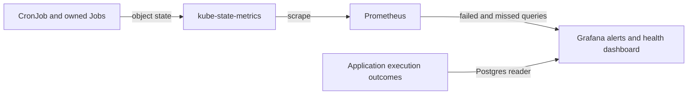

Every production CronJob has failed-Job and missed-schedule coverage. Rules live in `base/telemetry/` as ConfigMaps labeled `grafana_alert: "1"`; homelab-deployment's Grafana alert sidecar loads them into **Fantasy**. Dashboard: **Fantasy → Fantasy CronJob Health**.

Every row has **latest Job failed** and **missed scheduled run** alerts. Schedule fields, not comments that assume UTC, determine local run times.

See the generated [schedule inventory](schedules.md) for every CronJob, command, timezone and alert UID.

Daily/weekly runs retain the original 2h scheduling grace. Frequent jobs get two cadences: 20m for rapid status, 30m for the high-impact sweeper, and 60m for rumor ingestion. Waiting 2h would hide 12, 8, and 4 missed runs respectively. Rules evaluate every 5m and fire **strictly above** the grace; expect up to another 5m before evaluation. Grace concerns Job creation, not runtime or completion.



## States and alert meaning

| State | Evidence | Alert |
|---|---|---|
| Missed schedule | Expected next run is older than that job's grace | Fantasy CronJob missed its scheduled run (daily/weekly or cadence-specific rule) |
| Failed Job | Newest owned Job has `kube_job_failed{condition="true"} == 1` | Fantasy CronJob latest Job failed |
| Succeeded | Latest Job completed and last-success time advanced | none |

The table shows last scheduled/successful/next times, latest Job, active count, and grace for every watched job by default. A running Job is not proven successful merely because no failure condition exists: check **Active Jobs** and **Last successful**. Missing input series may leave fields blank; inspect telemetry before interpreting the state.

A successful optimizer with zero swaps is a normal no-op. Its log panel distinguishes `Lineup already optimal` from `Published N lineup swap(s)`. Missing input fails the Job after [core-pipeline#178](https://github.com/cvillarr23/fantasy-core-pipeline/issues/178); empty waiver pools fail after [#181](https://github.com/cvillarr23/fantasy-core-pipeline/issues/181).

## Fantasy CronJob latest Job failed

Only the newest Job per CronJob counts, selected by creation time and joined on `exported_namespace`/`job_name`. Old failures retained by history limits do not keep firing. A newer successful run clears the alert; a newer active run also supersedes an older failure. The summary includes Job name, creation time, and last successful run.

Read-only investigation:

```bash
kubectl describe job <job_name> -n default
kubectl logs job/<job_name> -n default --all-containers
# Init containers can fail before the main container starts:
kubectl logs job/<job_name> -n default -c sync-league       # weekly ingestor
kubectl logs job/<job_name> -n default -c draft-prep-refresher
```

If pods are gone, use Loki `{namespace="default", pod=~"<job_name>-.*"}`. Fix the dependency and allow the next scheduled run to recover. This verification procedure does not create Jobs or rerun workloads.

### What each job depends on

| CronJob | Check first |
|---|---|
| `espn-session-healthcheck` | ESPN reachability and `espn-session-secrets` (`espn_s2`/`swid`), league configuration, Postgres execution logging. Cookies require human refresh when expired. |
| `fantasy-draft-prep-refresher` | `draft-prep-refresher` container: Sleeper skill-position projections, ESPN K/D-ST projections (needs `espn-session-secrets` `espn_s2`/`swid`), then VORP for each horizon week. Check season/week/team configuration and Postgres credentials. It supplies target-week VORP for optimizer and waiver decisions and later-week VORP for trade scoring. |
| `fantasy-lineup-optimizer` | That day's 18:00 refresher, roster/weekly-stat rows, target-week VORP and prior-week fallback, Postgres, core API, trigger API key and downstream lineup processing. Zero swaps is success. |
| `fantasy-rapid-status-syncer` | Player-status source, Postgres, Redis and RabbitMQ credentials/connectivity; Thu/Sun/Mon are the only scheduled days. |
| `fantasy-rumor-action-trigger` | Rumor sync and today's 11:00 digest, rumor-signals rows, team/season config, Postgres, Redis, core API and downstream action processing. A successful Job is not proof of complete application processing; see the application alert below. |
| `fantasy-rumor-syncer` | External rumor sources, ingestion logs, Postgres and Redis; ingestion feeds the digest/action path. |
| `fantasy-stale-draft-job-sweeper` | `fantasy-core-pipeline` service account and draft-sync-orchestrator RBAC for listing/deleting Jobs, Postgres, RabbitMQ, Redis, and core API teardown. Verification only reads these resources. |
| `fantasy-sync-actual-scores` / `-reconcile` | ESPN cookies (`espn-session-secrets` `espn_s2`/`swid`) and `ESPN_LEAGUE_ID` from `fantasy-league-config`, the public NFL scoreboard, Postgres, and Redis for read-cache invalidation. Each run reprocesses every completed week. A week ESPN hasn't finished fails the Job with a reason such as `ESPN professional statistics are not official` or `NFL games are missing or not final`; weeks before it stay committed. Wait for the next scheduled run (Friday catches a Tuesday miss). Don't force a week with `--week`; it applies the same completeness checks. A success that logs no `Persisted ... week=N` for the just-finished week means ESPN hadn't rolled its scoring period yet. |
| `fantasy-weekly-ingestor` | `sync-league` init container, ESPN cookies and league config, external play-by-play source, Postgres. It refreshes rosters and historical metrics; it does not replace projection/VORP refresh. |
| `fantasy-weekly-waiver-trigger` | That day's 18:00 refresher and exact-week bench/free-agent pools, Postgres, core API and trigger API key, downstream RabbitMQ/browser-worker claims. It has no prior-week fallback. |
| `trade-inbox` | ESPN stored session/cookies, league/team configuration, Postgres inbox/execution logging, and core `POST /v1/trade/score`. No LLM keys. A completed Job can still contain unavailable/stale scores; inspect refresh logs and score outcomes. |
| `rumor-digest-bot` | Rumor inputs in Postgres, database/execution-log credentials and the Groq/Gemini LLM fallback credentials. No ESPN cookies or browser required. It runs at 11:00, before the 21:45 action trigger. |

[core-pipeline#140](https://github.com/cvillarr23/fantasy-core-pipeline/issues/140) owns
application outcomes for the shared rumor-action service (CLI and HTTP). Its
`rumor-action-trigger-failure` rule now lives in fantasy-infra; homelab-deployment retains
`rumor-digest-bot-failure`. See [application outcome](#rumor-action-application-outcome)
for semantics and the provisioning ownership handoff. Kubernetes alerts complement
these signals and do not validate partially processed actions.

### Tuesday ingestion and decision order

All times below use America/Chicago. Tuesday's sequence is `sync_league` →
metrics at 16:00 → completed fantasy scores at 17:05 → projections/K/D-ST/VORP
at 18:00 → lineup at 19:15 → waivers at 20:30 → rumor actions at 21:45. Each
gap exceeds the preceding Job's deadline (one hour; 30 minutes for scores).
Score sync follows the ingestor because it mirrors ESPN player actuals only
into `weekly_stats` rows the ingestor has created. The Friday 10:00
reconciliation run stores any week Tuesday couldn't (stats not yet official,
a postponed game) plus ESPN stat corrections before Friday's trade scan; the
trade context's opponent strength reads these stored scores. The daily refresher and rumor actions also use these
later slots on other days. The Wednesday/Friday 13:00 trade scan follows the
previous evening's projection/VORP rebuild.

The ingestor runs at 21:00Z during daylight saving time and 22:00Z during
standard time. On 2026-10-06, nflverse's current-season pbp assets were updated
at 15:53Z and schedules assets at 19:47–19:48Z. The later slot provides publication
headroom after Monday-night games. Release APIs expose only current asset timestamps;
four Tuesdays of upstream pbp workflow history are supporting timing evidence,
not a guarantee that each week's data will be complete.

The roster sync stays in the initContainer so it finishes before metrics and
that day's scheduled decisions. No early-Tuesday scheduled consumer requires it.
There is no second ingestion window: a successful partial ingestion would not
trigger an automatic retry, and a later correction would need another VORP rebuild
before dependent decisions. CronJobs enforce time spacing, not successful dependency
completion. Inspect ingestion counts and refresher logs before trusting a run's data;
the existing failed/missed Job alerts do not detect successful partial ingestion.

### Projection and VORP refresh horizon

The daily 18:00 America/Chicago refresher resolves the target week W once, then runs
`sync_projections` → `sync_kicker_dst` → `vorp_matrix` for each week from W through
min(W+3, 18), always finishing W before starting future weeks. A target above week 18
is an offseason no-op; a target below week 1 fails. Every command receives the same
configured season and its own week. Tuesday's lineup and waiver jobs run at
19:15 and 20:30 respectively.

Each week has a shared 600-second subprocess budget. The Job retains its 3600-second
deadline, which also bounds Pending time, and its existing CPU/memory requests and
limits. Work is sequential, so four weeks increase runtime without multiplying peak
resource demand. The four week budgets total 2400 seconds, leaving deadline headroom
for startup and scheduling. Scheduling delays can still affect the Tuesday consumers.

A failure or timeout in W stops the run immediately. A future-week failure skips that
week's remaining stages but allows the other weeks to refresh. Any failed week makes
the Job fail after processing finishes, so the existing latest-Job-failed alert also
reports an incomplete refresh horizon. Completed W writes remain committed and usable
even when the Job fails later. Steps commit independently; a failed week can retain
partial writes. `restartPolicy: Never` and `backoffLimit: 0` prevent an automatic
whole-run replay; ingestion's internal retries remain. Investigate the failed stage
and allow the next daily run to refresh the horizon.

Logs include season, week, stage, elapsed time and a `Refresh summary` with
`completed_weeks` and `failed_weeks`. A failed horizon does not advance the CronJob's
last-success timestamp even when W completed. The health dashboard shows whole-Job
state, not individual-week readiness. Missed-run grace still measures Job creation,
not completion or data availability.

Future-week rows intentionally enable the lineup optimizer's target-week source when
rostered non-K/D-ST VORP exists and the waiver service's exact-week pools when populated.
They are refreshed daily, but failed refreshes can leave older rows available. Empty
upstream responses are successful no-ops, not permission to copy another week's VORP
or synthesize missing projections. Missing weekly rows remain unscored by the trade
scorer. Existing Sleeper ingestion does not remove previously written skill-player
rows when a later response is empty; ESPN ingestion deletes matched K/D-ST target-week
rows whose projections are no longer present. The refresher preserves these behaviors.

Run `python3 -m unittest discover -s tests -p test_draft_prep_refresher.py` for offline
supervisor and production/draft-day render checks, and
`python3 -m unittest discover -s tests -p test_weekly_schedules.py` for dependency
spacing, roster-sync placement, and DST coverage. After rollout, observe a scheduled
run read-only: verify W completes before the Tuesday consumers, compare each week's
ingestion/VORP counts, and inspect the scorer's per-week coverage. Future projection
availability is provider-dependent: verify nonempty Sleeper `stats.pts_ppr` and ESPN
`kona_player_info` target-period projected stats rather than player counts alone.
Use read-only provider requests when investigating availability; ingestion commands
write to the database. Print counts and week identifiers, never session credentials.

## Fantasy CronJob missed its scheduled run

Each missed rule evaluates `time() - kube_cronjob_next_schedule_time` against its group's grace. Daily/weekly jobs share UID `fantasy-cronjob-missed-schedule`; three additional rules use suffixes `rapid`, `sweeper`, and `rumor` (UIDs stay within Grafana's 40-character limit). Each provisioning file/group has one rule, matching the Grafana convention and test renderer.

kube-state-metrics calculates the next timestamp from the schedule and timezone, advancing from the last scheduled run. The optimizer's missing 19:15 Tuesday run alerts after 21:15 Central in both CDT and CST. Rapid status naturally advances to the next Thu/Sun/Mon slot: a long inactive-day gap alone does not alert. A missed active-day slot remains overdue even if the grace crosses midnight.

Suspended jobs intentionally alert once overdue. Summaries show overdue duration, last success and suspension. All missed rules use `noDataState: Alerting` when the group's query has no series and `execErrState: Error`; missing one member of a multi-job group does not itself create a per-job no-data alert. A Job that starts but hangs needs separate runtime/completion monitoring.

```bash
kubectl get cronjob <cronjob> -n default -o wide
kubectl describe cronjob <cronjob> -n default
kubectl get deploy kube-state-metrics -n default
```

Check SUSPEND, LAST SCHEDULE, TIMEZONE and events (`MissSchedule`, `FailedCreate`, too many missed start times).

## Read-only live checks

```bash
kubectl get cronjobs -n default -o wide
kubectl get jobs -n default --sort-by=.metadata.creationTimestamp

promq() {
  kubectl get --raw "/api/v1/namespaces/default/services/prometheus:9090/proxy/api/v1/query?query=$(python3 -c 'import sys,urllib.parse;print(urllib.parse.quote(sys.argv[1]))' "$1")"
}
# Run each exact committed alert expression; empty results can mean healthy.
python3 tests/cronjob_alerts/render_rules.py
```

For each name in the inventory, query:

```promql
kube_cronjob_next_schedule_time{exported_namespace="default",cronjob="<cronjob>"}
kube_cronjob_status_last_schedule_time{exported_namespace="default",cronjob="<cronjob>"}
kube_cronjob_status_last_successful_time{exported_namespace="default",cronjob="<cronjob>"}
kube_job_owner{exported_namespace="default",owner_kind="CronJob",owner_name="<cronjob>"}
kube_job_created * on (exported_namespace,job_name) group_left (owner_name)
  kube_job_owner{exported_namespace="default",owner_kind="CronJob",owner_name="<cronjob>"}
kube_job_failed * on (exported_namespace,job_name) group_left (owner_name)
  kube_job_owner{exported_namespace="default",owner_kind="CronJob",owner_name="<cronjob>"}
```

Successful Jobs can have **no** `kube_job_failed` series. Confirm their Job conditions read-only and record this as expected absence, not a broken scrape. Never manufacture a failed Job to get a series. `exported_namespace` is the object's namespace; `namespace` is kube-state-metrics' namespace. Retention limits historical verification.

After merge, let ArgoCD apply the PR. Verify read-only that Grafana lists all failed/missed rule UIDs, their query groups match this inventory, and the dashboard shows a row for every watched CronJob with the right grace. Verify every job in the generated inventory; retained history limits the evidence available.

## Testing and adding coverage

The [CronJob alerts workflow](https://github.com/cvillarr23/fantasy-infra/blob/main/.github/workflows/cronjob-alerts.yml) runs this suite in CI on pull requests and pushes to `main` that change telemetry, the CronJob Health dashboard, core-pipeline or browser-worker CronJob manifests, the suite, or the workflow itself. It uses Python 3.11, PyYAML, and Docker with `prom/prometheus:v3.15.0` for promtool.

Run `./tests/cronjob_alerts/run.sh`. It renders committed alert and dashboard queries and runs Docker promtool fixtures covering every watched job's failure, success after historical failures, grace boundaries, suspended/resumed runs, CDT/CST, UTC healthcheck, rapid-status inactive days and unwatched jobs. Dashboard state and grace queries are checked against the same fixtures. Grafana's no-data policy requires live provisioning verification; promtool tests PromQL, not Grafana's evaluator.

For a new CronJob, update all failure selectors/context, select or add a missed-rule grace group, register new ConfigMaps, update dashboard inventory/grace and this table, then add firing/non-firing fixtures. Keep each rule's provisioning key and UID unique. Validate both production and draft-day renders.

## Rumor-action application outcome

**Rumor action incomplete or failed processing** (`rumor-action-trigger-failure`) complements
Kubernetes failed/missed Job alerts. The daily CronJob runs `python -m
src.services.rumor_action_service`, not the HTTP endpoint; both paths now record one
`execution_log` row with transaction type `rumor_action_trigger` and bot
`rumor_action_service`.

The rule lives in `base/telemetry/rumor-action-outcome-alert.yaml`, evaluates every 5m,
and fires immediately when any `failure` or `partial_failure` was recorded in the last
26h. It intentionally does not select just the latest execution: until core-pipeline#192
fixes retry/watermark semantics, an empty retry can otherwise erase evidence of lost
work. A recovered retry remains visible until the original failure ages out. This is
an observation window, not proof that the error remains unresolved.

No new signals after a successful fetch, low-confidence/non-actionable signals,
superseded signals, no beneficial move, and already-queued actions are healthy. Missing
identity mappings for proposed actions, incomplete accounting, evaluation failures and
publish failures alert. Signals and actions have separate counts: one signal may produce
multiple actions. “Accepted” means queued by the core API, not executed in ESPN.

Open **Fantasy → Fantasy Execution Log Overview → Rumor Action Outcomes** (panel 6).
Check `reason`, signal reasons, proposed/accepted/duplicate/missing/failed counts,
watermark range and `error_message`; use `job_name` for pod logs. Look for
`rumor_action_outcome` in Loki if PostgreSQL logging failed. An empty query returns zero;
a database query error uses Grafana's Error state. A run unable to persist its outcome
cannot be detected by this SQL rule: inspect the log fallback and Kubernetes alerts.
Missing runs are covered by #118, not by a zero-action threshold.

Do not blindly rerun: #192 is still responsible for retry safety and watermark recovery.
Investigate unresolved ESPN identities or input data before retrying. The app signal
also covers HTTP invocations; its failure count is per invocation, not per CronJob.

### Provisioning ownership and rollout

1. Deploy core-pipeline's additive `outcome_details JSONB` migration and service changes.
   Migrations run at API startup; confirm the column exists before expecting CronJob
   outcome writes or opening the new dashboard panel.
2. Remove homelab-deployment's old `rumor-action-trigger-failure.yaml` from its alerting
   ConfigMap generator and deployed ConfigMap. Do not provision `deleteRules`: the
   existing Grafana rule is retained until fantasy-infra takes ownership.
3. Deploy this fantasy-infra rule, retaining the old UID/group, folder and provisioning
   filename. Never leave two ConfigMaps supplying that same file/rule. Verify the
   Grafana rule shows the 26h SQL, 5m cadence and panel 6 link, and the new table displays
   structured outcomes. No live Jobs need to be triggered for verification.

Run `./tests/rumor_action_alert/run.sh` (Python/PyYAML and Docker). It tests the committed
SQL on isolated PostgreSQL 16: no data, healthy no-op, total/partial failure, failure then
success, unrelated rows, legacy rows and exact window boundaries. Existing CronJob
PromQL tests remain in `./tests/cronjob_alerts/run.sh`.

## Outgoing trade scan

`trade-scan` runs Wednesday and Friday 13:00 America/Chicago, directly in the worker image.
It allows one attempt per league/team/Chicago calendar date, shared with manual runs.
Deploy the browser-worker #94 image before syncing this CronJob; the production
Kustomize digest applies to it just like the other worker workloads. It reuses
worker secrets/config and stages proposals for separate human approval only.
There is intentionally no trade_proposals producer/scaler pair. See the worker
README's outgoing scan section for read-only manual checks, claim retention and
failure recovery. Suspend this job after the configured ESPN league trade deadline.
Off-season/duplicate/no-target outcomes are successful no-ops. Failures have no
automatic retry; inspect trade_scan logs and execution_log claims before recovery.
The 15-minute process and 16-minute Job deadlines bound execution and Pending time.

## Incoming trade inbox

`trade-inbox` runs eight times daily, 08:00 through 22:00 America/Chicago,
with `node src/bots/trade_inbox.js --refresh`. It only reads ESPN and persists
incoming offers in Postgres. The worker CLI defaults to `--check` (no database
writes); the scheduled command explicitly selects persistence. The process has a
ten-minute bound and the Job an eleven-minute deadline, with no automatic retry,
no concurrent scheduled runs, and a thirty-minute late-start allowance.

Wednesday/Friday's 13:00 trade scan also refreshes the inbox, between the noon and
14:00 inbox runs. There are 56 inbox runs and two additional scan refreshes weekly.
Each active-season refresh reads pending transactions once, optionally reads history
for vanished offers, and makes at most ten sequential core score calls. Unchanged
successful scores are reused. Core can read ESPN for cold scoring context. Offseason
runs are successful no-ops. These Jobs have separate concurrency policies; manual
runs or delayed runs are not globally serialized with the trade scan.

Deploy a worker image containing `src/bots/trade_inbox.js` and the `trade_responses`
consumer before syncing these resources. The production image transformer pins the
new CronJob to the same digest as the existing worker. The worker's core URL default
is `http://fantasy-core-pipeline.default.svc.cluster.local:8000`, matching trade-scan.
The inbox score timeout defaults to 20000 ms; `TRADE_SCORE_TIMEOUT_MS` stays unset.
`TRADE_RESPONSE_ENABLED` and both shadow thresholds stay unset; unset `DRY_RUN`
remains true. No accept, decline or counter is enabled by this rollout.

After Argo CD sync, inspect `kubectl get cronjob trade-inbox -n default -o yaml`,
Jobs/pods and `kubectl logs -n default job/<scheduled-job>`. Confirm the image,
command, safety configuration, deadlines, last-success time and `Refreshed` outcome
(including scoreCalls/exits). Verify the dashboard row and latest-failed/missed-run
alerts; missed-run grace is two hours and the overnight gap is intentional.
Do not create a manual refresh Job or send test queue messages for verification.
Core inbox API endpoints are not a prerequisite for this CronJob.
