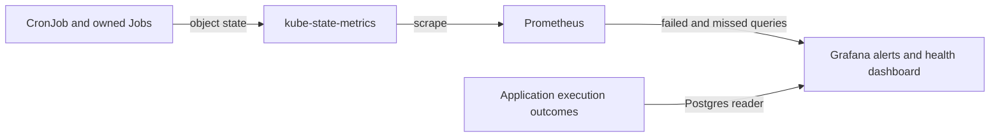

Every production CronJob has failed-Job and missed-schedule coverage. Jobs already moved to the launcher catalog alert from `run_log` instead; see [Launcher alerts](#launcher-alerts). Use this page to triage an alert, find what a job depends on and run read-only checks.

Rules live in `base/telemetry/` as ConfigMaps labeled `grafana_alert: "1"`. homelab-deployment's Grafana alert sidecar loads them into the **Fantasy** folder. The dashboard is **Fantasy → Fantasy CronJob Health**.



## Which alert fired?

Every row has a **latest Job failed** and a **missed scheduled run** alert. Schedule fields, not comments that assume UTC, determine local run times. The generated [schedule inventory](schedules.md) lists every CronJob, command, timezone and alert UID.

| Alert | Fires when | First check |
|---|---|---|
| Fantasy CronJob latest Job failed | The newest owned Job has `kube_job_failed{condition="true"} == 1`. | [Latest Job failed](#fantasy-cronjob-latest-job-failed) |
| Fantasy CronJob missed its scheduled run | The expected next run is older than that job's grace. | [Missed its scheduled run](#fantasy-cronjob-missed-its-scheduled-run) |
| Rumor action incomplete or failed processing | A `failure` or `partial_failure` was recorded in the last 26h. | [Application outcome](cronjob-application-outcomes.md#rumor-action-application-outcome) |

### Job states

| State | Evidence | Alert |
|---|---|---|
| Missed schedule | Expected next run is older than that job's grace | Fantasy CronJob missed its scheduled run (daily/weekly or cadence-specific rule) |
| Failed Job | Newest owned Job has `kube_job_failed{condition="true"} == 1` | Fantasy CronJob latest Job failed |
| Succeeded | Latest Job completed and last-success time advanced | none |

The dashboard table shows last scheduled, successful and next times, latest Job, active count and grace for every watched job. Missing input series may leave fields blank, so inspect telemetry before interpreting the state.

:::note[Running isn't succeeded]
A running Job isn't proven successful just because no failure condition exists. Check **Active Jobs** and **Last successful**.
:::

### Scheduling grace

Grace concerns Job creation, not runtime or completion. Rules evaluate every 5m and fire **strictly above** the grace, so expect up to another 5m before evaluation.

Every remaining CronJob runs daily or weekly and shares a 2h grace. The frequent syncers and the stale draft Job sweeper, which needed 20m to 60m graces, now run on the launcher.

## Fantasy CronJob latest Job failed

Only the newest Job per CronJob counts. It is selected by creation time and joined on `exported_namespace`/`job_name`. The alert summary includes the Job name, creation time and last successful run.

- Old failures retained by history limits don't keep firing.
- A newer successful run clears the alert.
- A newer active run also supersedes an older failure.

### Investigate (read-only)

```bash
kubectl describe job <job_name> -n default
kubectl logs job/<job_name> -n default --all-containers
```

If pods are gone, use Loki `{namespace="default", pod=~"<job_name>-.*"}`. Fix the dependency and let the next scheduled run recover. This procedure doesn't create Jobs or rerun workloads.

### What each job depends on

| CronJob | Check first |
|---|---|
| `fantasy-sync-actual-scores-reconcile` | ESPN cookies (`espn-session-secrets` `espn_s2`/`swid`) and `ESPN_LEAGUE_ID` from `espn-session-secrets`, the public NFL scoreboard, Postgres, and Redis for read-cache invalidation. See [score sync failures](#score-sync-failures). |
| `fantasy-trade-candidates` / `-prescan` | Core API startup migrations must create the candidate tables first. Needs league/team/season configuration, week resolution, trade context and refreshed projection/VORP inputs, Postgres and ESPN session secrets. Unresolved week or unavailable context fails the Job. Check the stored run's freshness before the scan; see [rollout and verification](cronjob-schedule-order.md#trade-candidate-rollout-and-verification). |
| `trade-inbox` | ESPN stored session/cookies, league/team configuration, Postgres inbox/execution logging, and core `POST /v1/trade/score`. No LLM keys. A completed Job can still contain unavailable or stale scores; inspect refresh logs and score outcomes. |

#### Score sync failures

Each score sync run (the `tuesday-weekly` chain's `sync-actual-scores` step and the Friday `fantasy-sync-actual-scores-reconcile` CronJob) reprocesses every completed week. A week ESPN hasn't finished fails the Job with a reason such as `ESPN professional statistics are not official` or `NFL games are missing or not final`. Weeks before it stay committed.

- Wait for the next scheduled run. Friday catches a Tuesday miss. On Tuesday the failed step doesn't hold up the chain: the projection refresh, lineup, waivers and rumor actions still run.
- Don't force a week with `--week`; it applies the same completeness checks.
- A success that logs no `Persisted ... week=N` for the just-finished week means ESPN hadn't rolled its scoring period yet.

:::note[Alert ownership]
[core-pipeline#140](https://github.com/cvillarr23/fantasy-core-pipeline/issues/140) owns application outcomes for the shared rumor-action service (CLI and HTTP). Its `rumor-action-trigger-failure` rule now lives in fantasy-infra, and homelab-deployment retains `rumor-digest-bot-failure`.

Kubernetes alerts complement these signals and don't validate partially processed actions.
:::

## Fantasy CronJob missed its scheduled run

Each missed rule evaluates `time() - kube_cronjob_next_schedule_time` against its group's grace. kube-state-metrics calculates the next timestamp from the schedule and timezone, advancing from the last scheduled run.

| Detail | Behavior |
|---|---|
| Rule UIDs | Every watched CronJob shares `fantasy-cronjob-missed-schedule`. |
| Provisioning | Each provisioning file/group has one rule, matching the Grafana convention and test renderer. |
| Example | A missing 22:00 trade-inbox run alerts after 00:00 Central, in both CDT and CST. |
| Suspended jobs | Alert once overdue, on purpose. Summaries show overdue duration, last success and suspension. |
| No data | `noDataState: Alerting` when the group's query has no series, and `execErrState: Error`. Missing one member of a multi-job group doesn't itself create a per-job no-data alert. |

:::warning[Hung jobs need other monitoring]
A Job that starts but hangs needs separate runtime or completion monitoring. Grace measures creation only.
:::

```bash
kubectl get cronjob <cronjob> -n default -o wide
kubectl describe cronjob <cronjob> -n default
kubectl get deploy kube-state-metrics -n default
```

Check SUSPEND, LAST SCHEDULE, TIMEZONE and events (`MissSchedule`, `FailedCreate`, too many missed start times).

## Read-only live checks

```bash
kubectl get cronjobs -n default -o wide
kubectl get jobs -n default --sort-by=.metadata.creationTimestamp

promq() {
  kubectl get --raw "/api/v1/namespaces/default/services/prometheus:9090/proxy/api/v1/query?query=$(python3 -c 'import sys,urllib.parse;print(urllib.parse.quote(sys.argv[1]))' "$1")"
}
# Run each exact committed alert expression; empty results can mean healthy.
python3 tests/cronjob_alerts/render_rules.py
```

<details>
<summary>PromQL queries per CronJob</summary>

For each name in the inventory, query:

```promql
kube_cronjob_next_schedule_time{exported_namespace="default",cronjob="<cronjob>"}
kube_cronjob_status_last_schedule_time{exported_namespace="default",cronjob="<cronjob>"}
kube_cronjob_status_last_successful_time{exported_namespace="default",cronjob="<cronjob>"}
kube_job_owner{exported_namespace="default",owner_kind="CronJob",owner_name="<cronjob>"}
kube_job_created * on (exported_namespace,job_name) group_left (owner_name)
  kube_job_owner{exported_namespace="default",owner_kind="CronJob",owner_name="<cronjob>"}
kube_job_failed * on (exported_namespace,job_name) group_left (owner_name)
  kube_job_owner{exported_namespace="default",owner_kind="CronJob",owner_name="<cronjob>"}
```

- Successful Jobs can have **no** `kube_job_failed` series. Confirm their Job conditions read-only and record this as expected absence, not a broken scrape.
- Never manufacture a failed Job to get a series.
- `exported_namespace` is the object's namespace. `namespace` is kube-state-metrics' namespace.
- Retention limits historical verification.

</details>

### After a merge

1. Let ArgoCD apply the PR.
2. Verify read-only that Grafana lists all failed and missed rule UIDs and that their query groups match the inventory.
3. Verify the dashboard shows a row for every watched CronJob with the right grace.
4. Verify every job in the generated inventory. Retained history limits the evidence available.

## Testing and adding coverage

The [CronJob alerts workflow](https://github.com/cvillarr23/fantasy-infra/blob/main/.github/workflows/cronjob-alerts.yml) runs the suite in CI on pull requests and pushes to `main` that change any of these:

- telemetry or the CronJob Health dashboard
- core-pipeline or browser-worker CronJob manifests
- the suite or the workflow itself

It uses Python 3.11, PyYAML, and Docker with `prom/prometheus:v3.15.0` for promtool.

Run `./tests/cronjob_alerts/run.sh`. It renders committed alert and dashboard queries and runs Docker promtool fixtures covering:

- every watched job's failure, and success after historical failures
- grace boundaries, and suspended or resumed runs
- CDT/CST
- unwatched jobs

Dashboard state and grace queries are checked against the same fixtures.

:::note[Promtool limits]
Grafana's no-data policy requires live provisioning verification. Promtool tests PromQL, not Grafana's evaluator.
:::

To add a CronJob:

1. Update all failure selectors and context.
2. Select or add a missed-rule grace group, and register new ConfigMaps.
3. Update the dashboard inventory and grace, and the dependency table on this page.
4. Add firing and non-firing fixtures.
5. Keep each rule's provisioning key and UID unique, and validate both production and draft-day renders.

## Launcher alerts

The [unified job launcher](adr/0001-unified-job-launcher.md) alerts from Postgres, not kube-state-metrics. Rules query `run_log` and `launcher_heartbeat` through the `FantasyFootballDB` datasource, load into the **Fantasy** folder like the rules above and route to the ntfy contact point. They read columns (`status`, `job_name`, `end_reason`, `attempt`, `chain_root_id`, `finished_at`), never keys inside `run_log.trigger`.

| Alert | Fires when | First check |
|---|---|---|
| Job launcher heartbeat stale | `launcher_heartbeat.at` is older than 5m, or there is no row | [Heartbeat stale](#launcher-heartbeat-stale) |
| Job launcher dead-letter queue not empty | `queue_depths->>'job_runs.dlq'` is above 0 | [DLQ not empty](#launcher-dlq-not-empty) |
| Job launcher cannot read its queues | The heartbeat is fresh but `job_runs` or its DLQ depth is null, for 2m | [Queue depth unknown](#launcher-queue-depth-unknown) |
| Job launcher job_runs backlog | `job_runs` depth stays above 0 for 15m | [Backlog](#launcher-job-runs-backlog) |
| Launcher run failed (critical / warning jobs) | A job at that `alert` level had a run end `failure` or `timeout` on its last attempt, or `skipped` for a reason that needs a person, in the last 10m. One series per job | [Run failed](#launcher-run-failed) |
| Job launcher chain ran past max_duration | A chain root ended `timeout` with `end_reason = 'max_duration'` in the last 10m | [Chain past max_duration](#launcher-chain-past-max-duration) |

### Launcher heartbeat stale

The launcher writes the row every 15s on its own thread, so a stale row means the process is down or stalled, or the database is unreachable from it. Nothing scheduled or on-demand starts meanwhile; catch-up windows cover short outages.

```bash
kubectl get deploy,pod -l app=fantasy-job-launcher -n default
kubectl logs deploy/fantasy-job-launcher -n default --tail=100
```

A launcher that refuses to start logs `Job catalog is not usable`; fix the catalog or the env it names.

### Launcher DLQ not empty

`job_runs.dlq` holds run commands the broker dead-lettered, such as a message that waited past the 6h TTL while the launcher was down. Inspect without consuming:

```bash
kubectl exec -n default deploy/fantasy-broker -c rabbitmq -- \
  rabbitmqctl list_queues -p / name messages_ready messages_unacknowledged
```

Decide with the owner whether each run is still wanted before replaying or purging; don't purge to silence the alert.

### Launcher queue depth unknown

The heartbeat is arriving but the launcher couldn't read a queue's depth: `job_runs` or `job_runs.dlq` is missing (the broker definitions didn't load) or the broker is unreachable from the launcher. It can't consume either way. Check `rabbitmqctl list_queues` as above and the launcher log for `Launcher queue depths unavailable`.

### Launcher job_runs backlog

`job_runs` has had messages for 15 minutes, though the launcher takes them promptly. The heartbeat thread is alive but the consumer is stalled or blocked. Check the launcher log and `run_log` rows stuck in `queued`.

### Launcher run failed

Rules are generated from `base/launcher/catalog.yaml`, because `run_log` doesn't record a job's `alert` level: the critical and warning rules each list the job names and `max_attempts` at that level, and an empty catalog matches nothing. Jobs with `alert: none` never alert. After editing the catalog, run `python3 scripts/generate-launcher-alerts.py` and commit the result; CI fails on a stale rule.

Each rule returns one series per job, so the page names the job, and carries a `severity` label (`critical` or `warning`) to route on. A failure or timeout alerts only on a job's last attempt (`attempt >= max_attempts`), or when a chain step's root has already ended, since the watcher can no longer retry it. Skips with `end_reason` `paused`, `chain_step`, `max_duration` or `chain_ended` are excluded: a chain timeout alerts once, on the chain rule. To inspect a run, query `run_log` by `job_name` and `finished_at`, then see `summary.log_tail`.

```bash
kubectl get jobs -n default -l fantasy.job=<job> --sort-by=.metadata.creationTimestamp
kubectl logs -n default -l fantasy.job=<job> --tail=200
```

A `skipped` run with `end_reason` `overlap` means the previous run, or its retry, was still running at the next slot. `expired` means the run couldn't start inside its schedule's `catch_up` window, or a chain step couldn't start within 30 minutes of its `latest` time. `dependency_failed` means a chain step's `on: success` parent didn't succeed; fix that parent first, since the skip is only its consequence.

#### What each launcher job depends on

| Job | Check first |
|---|---|
| `sync-league` | First `tuesday-weekly` step. ESPN cookies (`espn-session-secrets` `espn_s2`/`swid`), league configuration, Postgres. If it fails, `metrics-extractor` and `sync-actual-scores` are skipped (`dependency_failed`) and the rest of the chain still runs. |
| `metrics-extractor` | Runs after `sync-league` succeeds. External play-by-play source and Postgres. It refreshes historical metrics; it doesn't replace the projection/VORP refresh. |
| `sync-actual-scores` | Runs after `metrics-extractor` succeeds. Same dependencies as the reconcile CronJob; see [score sync failures](#score-sync-failures). |
| `projections-refresh` | Runs daily at 18:00 and in the chain once `sync-actual-scores` finishes. Sleeper skill-position projections, ESPN K/D-ST projections (needs `espn-session-secrets` `espn_s2`/`swid`), then VORP for each horizon week. Check season/week/team configuration and Postgres credentials. It supplies target-week VORP for lineup and waiver decisions and later-week VORP for trade scoring. Its stages are child runs in `run_log`. See the [refresh horizon](cronjob-schedule-order.md#projection-and-vorp-refresh-horizon). |
| `lineup-optimizer` | Critical. Runs once the refresh finishes, or at 19:15 at the latest. Roster/weekly-stat rows, target-week VORP and prior-week fallback, Postgres, core API, trigger API key and downstream lineup processing. Zero swaps is success: its dashboard log panel distinguishes `Lineup already optimal` from `Published N lineup swap(s)`. Missing input fails the run after [core-pipeline#178](https://github.com/cvillarr23/fantasy-core-pipeline/issues/178). |
| `waiver-trigger` | Critical. Runs once lineup finishes, or at 20:30 at the latest. Exact-week bench/free-agent pools from the refresh, Postgres, core API and trigger API key, downstream RabbitMQ/browser-worker claims. It has no prior-week fallback; empty pools fail the run after [core-pipeline#181](https://github.com/cvillarr23/fantasy-core-pipeline/issues/181). |
| `rumor-action-trigger` | Runs daily at 21:45 and in the chain once waivers finish. Rumor sync and today's 11:00 digest, rumor-signals rows, team/season config, Postgres, Redis, core API and downstream action processing. A successful run isn't proof of complete application processing; see [application outcome](cronjob-application-outcomes.md#rumor-action-application-outcome). |
| `espn-session-healthcheck` | ESPN reachability and `espn-session-secrets` (`espn_s2`/`swid`), league configuration, Postgres execution logging. Cookies require human refresh when expired. |
| `rapid-status-syncer` | Player-status source, Postgres, Redis and RabbitMQ credentials/connectivity. Thu/Sun/Mon are the only scheduled days. |
| `rumor-digest-bot` | Rumor inputs in Postgres, database/execution-log credentials and the Groq/Gemini LLM fallback credentials. No ESPN cookies or browser required. It runs at 11:00, before the 21:45 action trigger. |
| `rumor-syncer` | External rumor sources, ingestion logs, Postgres and Redis. Ingestion feeds the digest/action path. |
| `stale-draft-job-sweeper` | `fantasy-core-pipeline` service account (the `core-ops` profile) and draft-sync-orchestrator RBAC for listing/deleting Jobs, Postgres, RabbitMQ, Redis and core API teardown. Verification only reads these resources. |

### Launcher chain past max_duration

The scheduler ended a chain run because it outlasted the chain's `max_duration`, and skipped its unstarted steps. Look at the chain's `run_log` rows (`chain_root_id` = the root's `id`) for the step that was slow or never started.

### Testing launcher alerts

`./tests/launcher_alerts/run.sh` loads the committed SQL into a disposable `postgres:16` and asserts fire and no-fire cases for every rule, including the generated ones rendered from a fixture catalog. `python3 -m unittest tests.test_generate_launcher_alerts` checks the committed rules match the catalog.

## Related

- [Schedule order and refresh horizon](cronjob-schedule-order.md) for Tuesday ordering and the projection/VORP refresh.
- [Application outcomes and trade jobs](cronjob-application-outcomes.md) for the rumor-action alert, trade scan and trade inbox.
- [Schedules](schedules.md) for the generated inventory.
