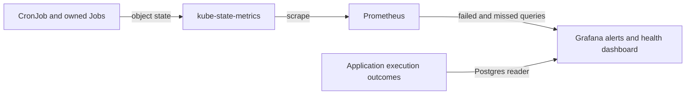

Every production CronJob has failed-Job and missed-schedule coverage. Use this page to triage an alert, find what a job depends on and run read-only checks.

Rules live in `base/telemetry/` as ConfigMaps labeled `grafana_alert: "1"`. homelab-deployment's Grafana alert sidecar loads them into the **Fantasy** folder. The dashboard is **Fantasy → Fantasy CronJob Health**.



## Which alert fired?

Every row has a **latest Job failed** and a **missed scheduled run** alert. Schedule fields, not comments that assume UTC, determine local run times. The generated [schedule inventory](schedules.md) lists every CronJob, command, timezone and alert UID.

| Alert | Fires when | First check |
|---|---|---|
| Fantasy CronJob latest Job failed | The newest owned Job has `kube_job_failed{condition="true"} == 1`. | [Latest Job failed](#fantasy-cronjob-latest-job-failed) |
| Fantasy CronJob missed its scheduled run | The expected next run is older than that job's grace. | [Missed its scheduled run](#fantasy-cronjob-missed-its-scheduled-run) |
| Rumor action incomplete or failed processing | A `failure` or `partial_failure` was recorded in the last 26h. | [Application outcome](cronjob-application-outcomes.md#rumor-action-application-outcome) |

### Job states

| State | Evidence | Alert |
|---|---|---|
| Missed schedule | Expected next run is older than that job's grace | Fantasy CronJob missed its scheduled run (daily/weekly or cadence-specific rule) |
| Failed Job | Newest owned Job has `kube_job_failed{condition="true"} == 1` | Fantasy CronJob latest Job failed |
| Succeeded | Latest Job completed and last-success time advanced | none |

The dashboard table shows last scheduled, successful and next times, latest Job, active count and grace for every watched job. Missing input series may leave fields blank, so inspect telemetry before interpreting the state.

:::note[Running isn't succeeded]
A running Job isn't proven successful just because no failure condition exists. Check **Active Jobs** and **Last successful**.
:::

A successful optimizer with zero swaps is a normal no-op. Its log panel distinguishes `Lineup already optimal` from `Published N lineup swap(s)`. Missing input fails the Job after [core-pipeline#178](https://github.com/cvillarr23/fantasy-core-pipeline/issues/178), and empty waiver pools fail after [#181](https://github.com/cvillarr23/fantasy-core-pipeline/issues/181).

### Scheduling grace

Grace concerns Job creation, not runtime or completion. Rules evaluate every 5m and fire **strictly above** the grace, so expect up to another 5m before evaluation.

| Group | Grace | Why not 2h |
|---|---|---|
| Daily and weekly runs | 2h | Original scheduling grace. |
| Rapid status (`rapid`) | 20m | 2h would hide 12 missed runs. |
| High-impact sweeper (`sweeper`) | 30m | 2h would hide 8 missed runs. |
| Rumor ingestion (`rumor`) | 60m | 2h would hide 4 missed runs. |

## Fantasy CronJob latest Job failed

Only the newest Job per CronJob counts. It is selected by creation time and joined on `exported_namespace`/`job_name`. The alert summary includes the Job name, creation time and last successful run.

- Old failures retained by history limits don't keep firing.
- A newer successful run clears the alert.
- A newer active run also supersedes an older failure.

### Investigate (read-only)

```bash
kubectl describe job <job_name> -n default
kubectl logs job/<job_name> -n default --all-containers
# Init containers can fail before the main container starts:
kubectl logs job/<job_name> -n default -c sync-league       # weekly ingestor
kubectl logs job/<job_name> -n default -c draft-prep-refresher
```

If pods are gone, use Loki `{namespace="default", pod=~"<job_name>-.*"}`. Fix the dependency and let the next scheduled run recover. This procedure doesn't create Jobs or rerun workloads.

### What each job depends on

| CronJob | Check first |
|---|---|
| `espn-session-healthcheck` | ESPN reachability and `espn-session-secrets` (`espn_s2`/`swid`), league configuration, Postgres execution logging. Cookies require human refresh when expired. |
| `fantasy-draft-prep-refresher` | `draft-prep-refresher` container: Sleeper skill-position projections, ESPN K/D-ST projections (needs `espn-session-secrets` `espn_s2`/`swid`), then VORP for each horizon week. Check season/week/team configuration and Postgres credentials. It supplies target-week VORP for optimizer and waiver decisions and later-week VORP for trade scoring. See the [refresh horizon](cronjob-schedule-order.md#projection-and-vorp-refresh-horizon). |
| `fantasy-lineup-optimizer` | That day's 18:00 refresher, roster/weekly-stat rows, target-week VORP and prior-week fallback, Postgres, core API, trigger API key and downstream lineup processing. Zero swaps is success. |
| `fantasy-rapid-status-syncer` | Player-status source, Postgres, Redis and RabbitMQ credentials/connectivity. Thu/Sun/Mon are the only scheduled days. |
| `fantasy-rumor-action-trigger` | Rumor sync and today's 11:00 digest, rumor-signals rows, team/season config, Postgres, Redis, core API and downstream action processing. A successful Job isn't proof of complete application processing; see [application outcome](cronjob-application-outcomes.md#rumor-action-application-outcome). |
| `fantasy-rumor-syncer` | External rumor sources, ingestion logs, Postgres and Redis. Ingestion feeds the digest/action path. |
| `fantasy-stale-draft-job-sweeper` | `fantasy-core-pipeline` service account and draft-sync-orchestrator RBAC for listing/deleting Jobs, Postgres, RabbitMQ, Redis and core API teardown. Verification only reads these resources. |
| `fantasy-sync-actual-scores` / `-reconcile` | ESPN cookies (`espn-session-secrets` `espn_s2`/`swid`) and `ESPN_LEAGUE_ID` from `espn-session-secrets`, the public NFL scoreboard, Postgres, and Redis for read-cache invalidation. See [score sync failures](#score-sync-failures). |
| `fantasy-trade-candidates` / `-prescan` | Core API startup migrations must create the candidate tables first. Needs league/team/season configuration, week resolution, trade context and refreshed projection/VORP inputs, Postgres and ESPN session secrets. Unresolved week or unavailable context fails the Job. Check the stored run's freshness before the scan; see [rollout and verification](cronjob-schedule-order.md#trade-candidate-rollout-and-verification). |
| `fantasy-weekly-ingestor` | `sync-league` init container, ESPN cookies and league config, external play-by-play source, Postgres. It refreshes rosters and historical metrics; it doesn't replace projection/VORP refresh. |
| `fantasy-weekly-waiver-trigger` | That day's 18:00 refresher and exact-week bench/free-agent pools, Postgres, core API and trigger API key, downstream RabbitMQ/browser-worker claims. It has no prior-week fallback. |
| `trade-inbox` | ESPN stored session/cookies, league/team configuration, Postgres inbox/execution logging, and core `POST /v1/trade/score`. No LLM keys. A completed Job can still contain unavailable or stale scores; inspect refresh logs and score outcomes. |
| `rumor-digest-bot` | Rumor inputs in Postgres, database/execution-log credentials and the Groq/Gemini LLM fallback credentials. No ESPN cookies or browser required. It runs at 11:00, before the 21:45 action trigger. |

#### Score sync failures

Each `fantasy-sync-actual-scores` run reprocesses every completed week. A week ESPN hasn't finished fails the Job with a reason such as `ESPN professional statistics are not official` or `NFL games are missing or not final`. Weeks before it stay committed.

- Wait for the next scheduled run. Friday catches a Tuesday miss.
- Don't force a week with `--week`; it applies the same completeness checks.
- A success that logs no `Persisted ... week=N` for the just-finished week means ESPN hadn't rolled its scoring period yet.

:::note[Alert ownership]
[core-pipeline#140](https://github.com/cvillarr23/fantasy-core-pipeline/issues/140) owns application outcomes for the shared rumor-action service (CLI and HTTP). Its `rumor-action-trigger-failure` rule now lives in fantasy-infra, and homelab-deployment retains `rumor-digest-bot-failure`.

Kubernetes alerts complement these signals and don't validate partially processed actions.
:::

## Fantasy CronJob missed its scheduled run

Each missed rule evaluates `time() - kube_cronjob_next_schedule_time` against its group's grace. kube-state-metrics calculates the next timestamp from the schedule and timezone, advancing from the last scheduled run.

| Detail | Behavior |
|---|---|
| Rule UIDs | Daily/weekly jobs share `fantasy-cronjob-missed-schedule`. Three more rules use suffixes `rapid`, `sweeper` and `rumor`, which keeps UIDs within Grafana's 40-character limit. |
| Provisioning | Each provisioning file/group has one rule, matching the Grafana convention and test renderer. |
| Optimizer example | A missing 19:15 Tuesday run alerts after 21:15 Central, in both CDT and CST. |
| Rapid status | Advances to the next Thu/Sun/Mon slot. A long inactive-day gap alone doesn't alert, but a missed active-day slot stays overdue even if the grace crosses midnight. |
| Suspended jobs | Alert once overdue, on purpose. Summaries show overdue duration, last success and suspension. |
| No data | `noDataState: Alerting` when the group's query has no series, and `execErrState: Error`. Missing one member of a multi-job group doesn't itself create a per-job no-data alert. |

:::warning[Hung jobs need other monitoring]
A Job that starts but hangs needs separate runtime or completion monitoring. Grace measures creation only.
:::

```bash
kubectl get cronjob <cronjob> -n default -o wide
kubectl describe cronjob <cronjob> -n default
kubectl get deploy kube-state-metrics -n default
```

Check SUSPEND, LAST SCHEDULE, TIMEZONE and events (`MissSchedule`, `FailedCreate`, too many missed start times).

## Read-only live checks

```bash
kubectl get cronjobs -n default -o wide
kubectl get jobs -n default --sort-by=.metadata.creationTimestamp

promq() {
  kubectl get --raw "/api/v1/namespaces/default/services/prometheus:9090/proxy/api/v1/query?query=$(python3 -c 'import sys,urllib.parse;print(urllib.parse.quote(sys.argv[1]))' "$1")"
}
# Run each exact committed alert expression; empty results can mean healthy.
python3 tests/cronjob_alerts/render_rules.py
```

<details>
<summary>PromQL queries per CronJob</summary>

For each name in the inventory, query:

```promql
kube_cronjob_next_schedule_time{exported_namespace="default",cronjob="<cronjob>"}
kube_cronjob_status_last_schedule_time{exported_namespace="default",cronjob="<cronjob>"}
kube_cronjob_status_last_successful_time{exported_namespace="default",cronjob="<cronjob>"}
kube_job_owner{exported_namespace="default",owner_kind="CronJob",owner_name="<cronjob>"}
kube_job_created * on (exported_namespace,job_name) group_left (owner_name)
  kube_job_owner{exported_namespace="default",owner_kind="CronJob",owner_name="<cronjob>"}
kube_job_failed * on (exported_namespace,job_name) group_left (owner_name)
  kube_job_owner{exported_namespace="default",owner_kind="CronJob",owner_name="<cronjob>"}
```

- Successful Jobs can have **no** `kube_job_failed` series. Confirm their Job conditions read-only and record this as expected absence, not a broken scrape.
- Never manufacture a failed Job to get a series.
- `exported_namespace` is the object's namespace. `namespace` is kube-state-metrics' namespace.
- Retention limits historical verification.

</details>

### After a merge

1. Let ArgoCD apply the PR.
2. Verify read-only that Grafana lists all failed and missed rule UIDs and that their query groups match the inventory.
3. Verify the dashboard shows a row for every watched CronJob with the right grace.
4. Verify every job in the generated inventory. Retained history limits the evidence available.

## Testing and adding coverage

The [CronJob alerts workflow](https://github.com/cvillarr23/fantasy-infra/blob/main/.github/workflows/cronjob-alerts.yml) runs the suite in CI on pull requests and pushes to `main` that change any of these:

- telemetry or the CronJob Health dashboard
- core-pipeline or browser-worker CronJob manifests
- the suite or the workflow itself

It uses Python 3.11, PyYAML, and Docker with `prom/prometheus:v3.15.0` for promtool.

Run `./tests/cronjob_alerts/run.sh`. It renders committed alert and dashboard queries and runs Docker promtool fixtures covering:

- every watched job's failure, and success after historical failures
- grace boundaries, and suspended or resumed runs
- CDT/CST, the UTC healthcheck, and rapid-status inactive days
- unwatched jobs

Dashboard state and grace queries are checked against the same fixtures.

:::note[Promtool limits]
Grafana's no-data policy requires live provisioning verification. Promtool tests PromQL, not Grafana's evaluator.
:::

To add a CronJob:

1. Update all failure selectors and context.
2. Select or add a missed-rule grace group, and register new ConfigMaps.
3. Update the dashboard inventory and grace, and the dependency table on this page.
4. Add firing and non-firing fixtures.
5. Keep each rule's provisioning key and UID unique, and validate both production and draft-day renders.

## Related

- [Schedule order and refresh horizon](cronjob-schedule-order.md) for Tuesday ordering and the projection/VORP refresh.
- [Application outcomes and trade jobs](cronjob-application-outcomes.md) for the rumor-action alert, trade scan and trade inbox.
- [Schedules](schedules.md) for the generated inventory.
