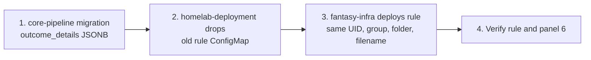

Use this page when the rumor-action outcome alert fires, or when you need the schedule and safety settings of `trade-scan` and `trade-inbox`. For Kubernetes failed and missed alerts, see [CronJob alerts](cronjob-alerts.md).

## Rumor-action application outcome

**Rumor action incomplete or failed processing** (`rumor-action-trigger-failure`) complements the Kubernetes failed and missed Job alerts. The daily CronJob runs `python -m src.services.rumor_action_service`, not the HTTP endpoint. Both paths record one `execution_log` row with transaction type `rumor_action_trigger` and bot `rumor_action_service`.

| Property | Value |
|---|---|
| Rule file | `base/telemetry/rumor-action-outcome-alert.yaml` |
| Evaluation | Every 5m |
| Fires | Immediately when any `failure` or `partial_failure` was recorded in the last 26h |
| Dashboard | **Fantasy → Fantasy Execution Log Overview → Rumor Action Outcomes** (panel 6) |

:::note[Why it doesn't select only the latest run]
Until core-pipeline#192 fixes retry and watermark semantics, an empty retry could otherwise erase evidence of lost work. A recovered retry stays visible until the original failure ages out. This is an observation window, not proof that the error remains unresolved.
:::

### What counts as healthy

| Healthy | Alerts |
|---|---|
| No new signals after a successful fetch | Missing identity mappings for proposed actions |
| Low-confidence or non-actionable signals | Incomplete accounting |
| Superseded signals | Evaluation failures |
| No beneficial move | Publish failures |
| Already-queued actions | |

Signals and actions have separate counts, since one signal may produce multiple actions. “Accepted” means queued by the core API, not executed in ESPN.

### Investigate

1. Open panel 6 and check `reason` and the signal reasons.
2. Check the proposed, accepted, duplicate, missing and failed counts.
3. Check the watermark range and `error_message`.
4. Use `job_name` for pod logs.
5. Look for `rumor_action_outcome` in Loki if PostgreSQL logging failed.

| Situation | What happens |
|---|---|
| Empty query | Returns zero. |
| Database query error | Uses Grafana's Error state. |
| Run couldn't persist its outcome | This SQL rule can't detect it. Inspect the log fallback and Kubernetes alerts. |
| Missing runs | Covered by #118, not by a zero-action threshold. |

:::danger[Don't blindly rerun]
#192 is still responsible for retry safety and watermark recovery. Investigate unresolved ESPN identities or input data before retrying.
:::

The app signal also covers HTTP invocations, and its failure count is per invocation, not per CronJob.

### Provisioning ownership and rollout

1. Deploy core-pipeline's additive `outcome_details JSONB` migration and service changes. Migrations run at API startup, so confirm the column exists before expecting CronJob outcome writes or opening the new dashboard panel.
2. Remove homelab-deployment's old `rumor-action-trigger-failure.yaml` from its alerting ConfigMap generator and deployed ConfigMap. Don't provision `deleteRules`: the existing Grafana rule is retained until fantasy-infra takes ownership.
3. Deploy this fantasy-infra rule, retaining the old UID/group, folder and provisioning filename.
4. Verify the Grafana rule shows the 26h SQL, 5m cadence and panel 6 link, and that the new table displays structured outcomes. No live Jobs need to be triggered.

:::warning[One owner per rule]
Never leave two ConfigMaps supplying the same file or rule.
:::

Run `./tests/rumor_action_alert/run.sh` (Python/PyYAML and Docker). It tests the committed SQL on isolated PostgreSQL 16 for:

- no data and a healthy no-op
- total and partial failure, and failure then success
- unrelated rows and legacy rows
- exact window boundaries

Existing CronJob PromQL tests remain in `./tests/cronjob_alerts/run.sh`.

## Outgoing trade scan

`trade-scan` runs in the worker image and stages proposals for separate human approval only.

| Setting | Value |
|---|---|
| Schedule | Wednesday and Friday 13:00 America/Chicago |
| Attempts | One per league/team/Chicago calendar date, shared with manual runs |
| Process bound / Job deadline | 15 minutes / 16 minutes (the deadline also bounds Pending time) |
| Retries | None automatic |
| Secrets and config | Reuses worker secrets and config |
| Image | Production Kustomize digest applies, like the other worker workloads |
| Producers | No `trade_proposals` producer/scaler pair, on purpose |

- Deploy the browser-worker #94 image before syncing this CronJob.
- Off-season, duplicate and no-target outcomes are successful no-ops.
- Failures have no automatic retry. Inspect `trade_scan` logs and `execution_log` claims before recovery.
- Suspend this job after the configured ESPN league trade deadline.
- See the worker README's outgoing scan section for read-only manual checks, claim retention and failure recovery.

## Incoming trade inbox

`trade-inbox` runs `node src/bots/trade_inbox.js --refresh`. It only reads ESPN and persists incoming offers in Postgres.

| Setting | Value |
|---|---|
| Schedule | Eight times daily, 08:00 through 22:00 America/Chicago |
| Weekly runs | 56 inbox runs, plus two refreshes from the Wednesday/Friday 13:00 trade scan (between the noon and 14:00 inbox runs) |
| Persistence | The worker CLI defaults to `--check` (no database writes). The scheduled command selects persistence explicitly. |
| Bounds | Ten-minute process, eleven-minute Job deadline, thirty-minute late-start allowance |
| Concurrency | No concurrent scheduled runs and no automatic retry. Manual or delayed runs aren't globally serialized with the trade scan. |
| Core URL | Worker default `http://fantasy-core-pipeline.default.svc.cluster.local:8000`, matching trade-scan |
| Score timeout | Defaults to 20000 ms. `TRADE_SCORE_TIMEOUT_MS` stays unset. |

Each active-season refresh does the following:

- reads pending transactions once
- optionally reads history for vanished offers
- makes at most ten sequential core score calls, and reuses unchanged successful scores

Core can read ESPN for cold scoring context. Offseason runs are successful no-ops.

:::warning[No responses are enabled]
`TRADE_RESPONSE_ENABLED` and both shadow thresholds stay unset, and unset `DRY_RUN` remains true. No accept, decline or counter is enabled by this rollout.
:::

### Roll out and verify

1. Deploy a worker image containing `src/bots/trade_inbox.js` and the `trade_responses` consumer before syncing these resources. The production image transformer pins the new CronJob to the same digest as the existing worker.
2. After the Argo CD sync, inspect `kubectl get cronjob trade-inbox -n default -o yaml`, Jobs and pods, and `kubectl logs -n default job/<scheduled-job>`.
3. Confirm the image, command, safety configuration, deadlines, last-success time and `Refreshed` outcome (including scoreCalls/exits).
4. Verify the dashboard row and the latest-failed and missed-run alerts. Missed-run grace is two hours, and the overnight gap is intentional.

:::note[Don't create test traffic]
Don't create a manual refresh Job or send test queue messages for verification. Core inbox API endpoints aren't a prerequisite for this CronJob.
:::
