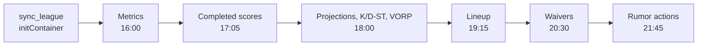
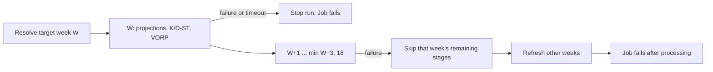

Use this page to understand the dependency order of the Tuesday jobs and what the daily projection/VORP refresh does when a stage fails. For triage, start at [CronJob alerts](cronjob-alerts.md).

## Why do Tuesday jobs run in this order?

All times use America/Chicago.

Each gap exceeds the preceding Job's deadline: one hour, or 30 minutes for scores. Only spacing is enforced. CronJobs don't wait for the previous job to succeed.

| Job | Placement reason |
|---|---|
| Score sync (17:05) | Mirrors ESPN player actuals only into `weekly_stats` rows the ingestor has created, so it follows the ingestor. |
| Friday 10:00 reconciliation | Stores any week Tuesday couldn't (stats not yet official, a postponed game) plus ESPN stat corrections, before Friday's trade scan. The trade context's opponent strength reads these stored scores. |
| Daily 07:00 trade candidates | Follows the previous evening's 18:00 projection/VORP rebuild and the most recent weekly metrics ingestion. |
| Wednesday/Friday 12:30 trade candidates | Refreshes stored candidates after Friday's 10:00 score reconciliation and before the 13:00 scan. |
| Wednesday/Friday 13:00 trade scan | Follows the previous evening's projection/VORP rebuild and the 12:30 candidate run. |
| Daily refresher and rumor actions | Also use these later slots on other days. |

### Trade-candidate rollout and verification

Deploy a core API image containing the trade-candidate module and migrations first. Its startup `run_migrations()` must create `trade_candidate_runs` and `trade_candidates` before either CronJob runs. Both jobs inherit the core image digest from the overlay, just like the API deployment.

`fantasy-trade-candidates` runs daily at 07:00 and `fantasy-trade-candidates-prescan` runs Wednesday/Friday at 12:30, all in America/Chicago across DST. They run `python -m src.jobs.trade_candidates`, resolving the upcoming week from the configured season without a fixed week argument. The daily slot uses the previous evening's refresh; there is no morning metrics refresh.

Both jobs forbid overlapping runs within their own CronJob, allow at most two minutes of scheduling delay and have a 25-minute deadline including Pending time. There are no automatic retries. Finished Jobs expire after seven days. The two schedules cannot overlap under these bounds; late runs are skipped rather than replayed near a scan. The pre-scan run has three minutes of headroom before 13:00. Scheduling provides spacing, not a success dependency: a failed refresh or candidate run does not stop the scan.

After rollout, check the Job logs and the `trade_candidates` run audit entry, tagged with `RUN_CRONJOB` and the actual Kubernetes Job name through `RUN_K8S_JOB`. Verify a fresh stored candidate run for the upcoming week lands before each scan. An unresolved week or unavailable trade context exits 1 and triggers the latest-Job-failed alert; offseason exits successfully without writing candidates. Failed and missed-run alerts and the CronJob health dashboard cover both schedules, with the standard two-hour missed-run grace; these alerts do not guarantee readiness by 13:00.

### Ingestion timing

The ingestor runs at 21:00Z during daylight saving time and 22:00Z during standard time. The later slot gives publication headroom after Monday-night games.

| Evidence (2026-10-06) | Timestamp |
|---|---|
| nflverse current-season pbp assets updated | 15:53Z |
| nflverse schedules assets updated | 19:47–19:48Z |

Release APIs expose only current asset timestamps. Four Tuesdays of upstream pbp workflow history are supporting timing evidence, not a guarantee that each week's data is complete.

### Ingestion limits

:::warning[A partial ingestion isn't retried]
There is no second ingestion window. A successful partial ingestion doesn't trigger an automatic retry, and a later correction needs another VORP rebuild before dependent decisions.
:::

- The roster sync stays in the initContainer so it finishes before metrics and that day's scheduled decisions. No early-Tuesday scheduled consumer requires it.
- Inspect ingestion counts and refresher logs before trusting a run's data.
- The failed and missed Job alerts don't detect a successful partial ingestion.

## Projection and VORP refresh horizon

The daily 18:00 America/Chicago refresher resolves the target week W once. For each week from W through min(W+3, 18) it runs `sync_projections` → `sync_kicker_dst` → `vorp_matrix`, and it always finishes W before future weeks. Every command receives the same configured season and its own week.

| Case | Behavior |
|---|---|
| Target above week 18 | Offseason no-op. |
| Target below week 1 | Fails. |
| Per-week budget | Shared 600-second subprocess budget per week. Four weeks total 2400 seconds. |
| Job deadline | Stays 3600 seconds, which also bounds Pending time and leaves headroom for startup and scheduling. |
| Resources | Existing CPU/memory requests and limits are unchanged. Work is sequential, so four weeks increase runtime without multiplying peak demand. |
| Failure in W | Stops the run immediately. |
| Failure in a future week | Skips that week's remaining stages but allows the other weeks to refresh. |
| Any failed week | The Job fails after processing finishes, so the latest-Job-failed alert also reports an incomplete horizon. |
| Retries | `restartPolicy: Never` and `backoffLimit: 0` prevent an automatic whole-run replay. Ingestion's internal retries remain. |

Scheduling delays can still affect the Tuesday consumers. Completed W writes remain committed and usable even when the Job fails later. Steps commit independently, so a failed week can retain partial writes.

To recover, investigate the failed stage and let the next daily run refresh the horizon.

### What to read in the logs and dashboard

- Logs include season, week, stage, elapsed time and a `Refresh summary` with `completed_weeks` and `failed_weeks`.
- A failed horizon doesn't advance the CronJob's last-success timestamp, even when W completed.
- The health dashboard shows whole-Job state, not individual-week readiness.
- Missed-run grace still measures Job creation, not completion or data availability.

### Future-week data

Future-week rows feed two consumers when populated: the lineup optimizer's target-week source (when rostered non-K/D-ST VORP exists) and the waiver service's exact-week pools. They are refreshed daily, but failed refreshes can leave older rows available.

- Empty upstream responses are successful no-ops. They aren't permission to copy another week's VORP or synthesize missing projections.
- Missing weekly rows stay unscored by the trade scorer.
- Sleeper ingestion doesn't remove previously written skill-player rows when a later response is empty.
- ESPN ingestion deletes matched K/D-ST target-week rows whose projections are no longer present.
- The refresher preserves all of these behaviors.

### Verify a rollout

| Check | How |
|---|---|
| Supervisor and production/draft-day renders (offline) | `python3 -m unittest discover -s tests -p test_draft_prep_refresher.py` |
| Dependency spacing, roster-sync placement, DST coverage | `python3 -m unittest discover -s tests -p test_weekly_schedules.py` |
| A scheduled run, read-only | Verify W completes before the Tuesday consumers, compare each week's ingestion/VORP counts and inspect the scorer's per-week coverage. |
| Provider availability | Verify nonempty Sleeper `stats.pts_ppr` and ESPN `kona_player_info` target-period projected stats, not player counts alone. |

:::warning[Read-only provider requests]
Use read-only provider requests when investigating availability. Ingestion commands write to the database. Print counts and week identifiers, never session credentials.
:::
