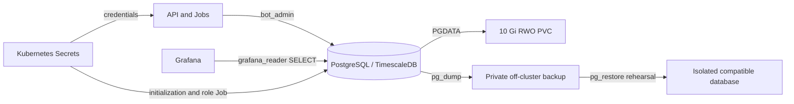

`fantasy-db` runs one PostgreSQL 15/TimescaleDB pod with persistent storage. This repository supplies no database backup CronJob or automated restore workflow; configure and test backups separately.



## Inspect storage and access

| Setting | Manifest behavior |
|---|---|
| StatefulSet | `fantasy-db`, one replica; no HA/failover |
| Image | `timescale/timescaledb:latest-pg15`; floating dependency tag, separate from application digest pins |
| Database / writer | `fantasy_football` / `bot_admin` |
| Storage | `db-storage` claim template, 10 Gi, ReadWriteOnce, default StorageClass |
| Data directory | `pgdata` beneath the data mount to avoid initializing a nonempty volume root |
| Production connections | `max_connections=20`; draft-day raises it to 50 |
| Credentials | Secret references populated by External Secrets Operator; never store passwords in Git |

```bash
kubectl get statefulset fantasy-db -n default
kubectl get pvc -n default
kubectl describe pod fantasy-db-0 -n default
kubectl logs fantasy-db-0 -n default -c postgres --tail=100
```

A PVC surviving a pod restart is persistence, not a backup. Record the storage provider's retention/reclaim policy and failure domain before maintenance.

## Back up the database

:::info[Prerequisites]
Use a private workstation with `kubectl` access, enough disk space and an encrypted off-cluster destination. Dumps contain private league data. Select a compatible PostgreSQL/TimescaleDB restore environment and record the installed extension version.
:::

1. Create a custom-format logical dump without printing credentials:

   ```bash
   umask 077
   kubectl exec -n default fantasy-db-0 -c postgres -- \
     sh -c 'PGPASSWORD="$POSTGRES_PASSWORD" pg_dump -h 127.0.0.1 -U "$POSTGRES_USER" -d "$POSTGRES_DB" -Fc --no-owner --no-acl' \
     > fantasy-db.dump
   ```

2. Check the command's exit status and list the archive with a compatible local `pg_restore --list fantasy-db.dump`.
3. Store the dump and checksum off-cluster, encrypted, with retention and restore-owner details. Record database/extension versions and source revision privately.
4. Restore to an isolated database and check table counts, representative queries and TimescaleDB objects. Archive readability alone does not prove recoverability.

## Restore to an isolated target

1. Provision an empty PostgreSQL target with the same compatible TimescaleDB extension version. Keep it disconnected from API, CronJobs and queue consumers.
2. Supply a restricted local libpq password file; use synthetic connection values in shared instructions:

   ```bash
   export PGHOST=restore-db.example.com PGPORT=5432
   export PGUSER=restore_admin PGDATABASE=fantasy_restore
   export PGPASSFILE=/private/location/restore.pgpass
   psql -v ON_ERROR_STOP=1 -c 'CREATE EXTENSION IF NOT EXISTS timescaledb;'
   psql -v ON_ERROR_STOP=1 -c 'SELECT timescaledb_pre_restore();'
   pg_restore --exit-on-error --no-owner --no-acl --dbname="$PGDATABASE" fantasy-db.dump
   psql -v ON_ERROR_STOP=1 -c 'SELECT timescaledb_post_restore();'
   ```

3. Verify schema, row counts, extension objects and application read queries. Recreate roles/grants separately: this dump intentionally excludes ownership and ACLs.
4. For production recovery, schedule downtime, pause writers/consumers, take a final backup and agree on the cutover before changing storage or connection settings. Preserve the original PVC until validation completes.

Follow the [TimescaleDB logical restore procedure](https://www.tigerdata.com/docs/deploy/self-hosted/backup-and-restore/logical-backup). Keep restore serial: parallel `pg_restore -j` does not correctly restore TimescaleDB catalogs. If restore fails, keep the target isolated and investigate before returning it to normal operation.

:::warning[Restore does not undo ESPN actions]
Historical database state can disagree with queued work or completed external moves. Reconcile execution records and broker messages before resuming publishers. Never replay queues merely because a restore succeeded.
:::

## Maintain the read-only role

`postgres-readonly-role-init` is an idempotent one-shot Job. It creates or rotates `grafana_reader`, grants database connect, public-schema usage and SELECT on existing tables, then sets default table SELECT privileges for objects created by the executing role.

Grafana's datasource lives in the cluster repository and uses this reader credential, not `bot_admin`. Tables created by another owner need that owner's default privileges configured separately.

Changing the reader Secret does not rerun a completed Job. Coordinate an explicit reprovisioning run and datasource refresh after rotation; verify a read query succeeds and write privileges remain absent.

Related: [Secrets](secrets.md), [Operations](operations.md).
