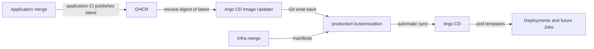

Argo CD reconciles `overlays/production` from the default branch. Application image releases reach production through digest updates committed by Argo CD Image Updater.



## Choose the overlay

| Path | Purpose |
|---|---|
| `base/` | Databases, API, UI, OAuth proxy, CronJobs, worker scaler, telemetry and image updater resources |
| `overlays/production/` | Base plus configuration, ExternalSecrets and application image digests |
| `overlays/draft-day/` | Inherits production; increases API resources and Postgres buffers/connections, keeps one worker warm and disables its idle exit |

:::note[Draft-day is an explicit switch]
The registered Application selects production. Merging draft-day patches does not select that overlay. Coordinate any Application path change in the cluster repository, then return it to production after the window.
:::

## Find the Argo CD configuration

| Resource | Owner and behavior |
|---|---|
| `fantasy-infra` Application | Cluster repository's `argo-controllers/fantasy-infra.yaml`; destination namespace `default`, source revision `HEAD`, automated prune and self-heal |
| Argo CD controller Application | Cluster repository's `argo-controllers/argocd.yaml`; installs the shared controller |
| Image Updater | This repository's `base/argocd-image-updater/`; GHCR registry configuration, RBAC and deployment in `argocd` |
| Update annotations | On `fantasy-infra`; `digest` strategy for API, UI and browser-worker `latest`, Git write-back to `main`, target `kustomization` |

The production `images` transformer pins application `image:` fields, including CronJobs and the ScaledJob. Replacements also copy the transformed API and worker images into `DRAFT_SYNC_IMAGE` and `BROWSER_WORKER_IMAGE`, which the API uses for runtime-created draft Jobs.

:::warning[Existing Jobs keep their image]
Changing a CronJob or ScaledJob template affects future Jobs. Inspect active Jobs separately; deployment health alone does not prove every workload uses the new digest.
:::

## Validate before merging

:::info[Prerequisites]
Install `kubectl` with Kustomize support. The cluster needs Kubernetes 1.27+ for CronJob timezones, Argo CD, KEDA, Tailscale ingress, a default StorageClass, and OpenBao with External Secrets Operator.
:::

1. Render both overlays locally:

   ```bash
   kubectl kustomize overlays/production/ > /tmp/fantasy-production.yaml
   kubectl kustomize overlays/draft-day/ > /tmp/fantasy-draft-day.yaml
   ./scripts/preflight-draft-sync-env.sh
   ```

2. Review the rendered images, runtime Job image variables and resource changes. Treat rendered configuration as private: it contains deployment-specific settings.
3. Merge the reviewed infra change. Argo CD applies it automatically; Image Updater may subsequently commit newer application digests.
4. Verify the Application revision, health and workload image evidence below.

## Verify the running digest

```bash
kubectl get application fantasy-infra -n argocd \
  -o jsonpath='{.status.sync.revision}{"\n"}{.status.sync.status}{"\n"}{.status.health.status}{"\n"}'
kubectl rollout status deployment/fantasy-core-pipeline -n default
kubectl rollout status deployment/fantasy-web-ui -n default
kubectl get pods -n default \
  -o jsonpath='{range .items[*]}{.metadata.name}{"\t"}{range .status.containerStatuses[*]}{.name}{"="}{.imageID}{" "}{end}{"\n"}{end}'
```

Compare the reconciled revision's `overlays/production/kustomization.yaml` with pod `imageID` values and the rendered templates. For multi-platform images, the runtime platform digest can differ from the pinned index digest; resolve its registry manifest before calling that a mismatch.

Check the API Deployment's two runtime image variables and the actual draft Job pod when investigating stale draft code. Confirm desired replicas are updated and available; a successful sync can precede pod readiness.

| Symptom | Check |
|---|---|
| Merge has no image update | Application CI publish, GHCR access, updater logs, annotations and Git write-back credentials |
| Sync fails | Application conditions/events, render errors and missing CRDs or Secrets |
| API updated but draft Job is old | Replacement output, active Job creation time and pod image ID |

Related: [Rollback runbook](operations.md#roll-back-a-deploy), [Secrets](secrets.md).
