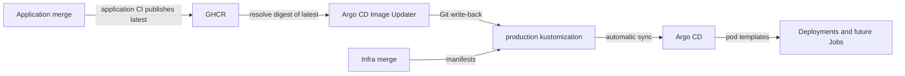
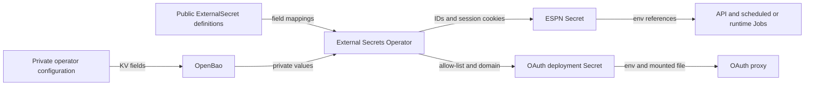

Argo CD reconciles `overlays/production` from the default branch. Application image releases reach production through digest updates committed by Argo CD Image Updater.



## Choose the overlay

| Path | Purpose |
|---|---|
| `base/` | Databases, API, UI, OAuth proxy, CronJobs, worker scaler, telemetry and image updater resources |
| `overlays/production/` | Base plus configuration, ExternalSecrets and application image digests |
| `overlays/draft-day/` | Inherits production; increases API resources and Postgres buffers/connections, keeps one worker warm and disables its idle exit |

## Supply private deployment values

League/team IDs, the approved-email list and public OAuth domain live in OpenBao. The public overlays contain references only; DNS, tunnel routes and OAuth provider registration stay in your private deployment configuration.



| OpenBao KV v2 path | Required properties | Kubernetes target |
|---|---|---|
| `secret/fantasy/deployment` | `ESPN_LEAGUE_ID`, `ESPN_TEAM_ID` (strings) | `espn-session-secrets`, alongside existing session keys |
| `secret/fantasy/oauth2-proxy-deployment` | `authenticated-emails-list` (one email per line), `redirect-url`, `cookie-domain` | `oauth2-proxy-deployment-config` |

Keep `CURRENT_YEAR`, `SPORT_TYPE` and `AUTO_PUBLISH_IR_MOVES` in the public `fantasy-league-config` ConfigMap. Every workload consuming that ConfigMap reads the IDs through required Secret references; runtime draft Jobs inherit the same IDs through `DRAFT_SYNC_ENV_SECRET`.

For a new installation, provision both private paths through your authenticated operator workflow before the first sync. Use `https://draft.example.com/oauth2/callback` and `draft.example.com` as domain examples, and `operator@example.com` as a synthetic email; supply your actual league/team IDs privately. Register the exact callback with Google and align the cookie domain, TLS proxy route and DNS.

:::warning[Provision before merging the migration]
Missing private fields make ExternalSecrets fail reconciliation and new pods fail startup. The existing ESPN cookie fields must remain in `secret/fantasy/espn`; do not replace that record with deployment IDs. Ensure the shared store's policy permits reading both new paths.
:::

For an existing deployment, run the migration while the old ConfigMap and OAuth arguments still exist:

```bash
# Read and validate live configuration and destinations; performs no writes.
python3 scripts/migrate-deployment-values.py
# Create missing paths with CAS=0, then verify without printing values.
python3 scripts/migrate-deployment-values.py --apply
```

The helper requires authenticated `kubectl` and `bao` access. It sends values through stdin, refuses to overwrite different destination data, and leaves the cluster untouched. Keep any manual inspection private; the helper suppresses raw CLI errors and values.

After provisioning, merge the manifests and let Argo CD reconcile. Verify both ExternalSecrets report Ready, the API and OAuth Deployment rollouts complete, and `fantasy-infra` is Synced and Healthy. Confirm an approved account can log in and an unlisted account cannot; the proxy uses only the file allow-list, with no domain-wide admission flag.

When IDs or OAuth settings change later, wait for Secret reconciliation and restart the API/OAuth deployments through your normal operator workflow. Environment variables refresh in new pods, and future scheduled/runtime Jobs read the new Secret values. Existing Jobs keep their initial environment; account for them before changing identity.

:::note[Draft-day is an explicit switch]
The registered Application selects production. Merging draft-day patches does not select that overlay. Coordinate any Application path change in the cluster repository, then return it to production after the window.
:::

## Find the Argo CD configuration

| Resource | Owner and behavior |
|---|---|
| `fantasy-infra` Application | Cluster repository's `argo-controllers/fantasy-infra.yaml`; destination namespace `default`, source revision `HEAD`, automated prune and self-heal |
| Argo CD controller Application | Cluster repository's `argo-controllers/argocd.yaml`; installs the shared controller |
| Image Updater | This repository's `base/argocd-image-updater/`; GHCR registry configuration, RBAC and deployment in `argocd` |
| Update annotations | On `fantasy-infra`; `digest` strategy for API, UI and browser-worker `latest`, Git write-back to `main`, target `kustomization` |

The production `images` transformer pins application `image:` fields, including CronJobs and the ScaledJob. Replacements also copy the transformed API and worker images into `DRAFT_SYNC_IMAGE` and `BROWSER_WORKER_IMAGE`, which the API uses for runtime-created draft Jobs.

:::warning[Existing Jobs keep their image]
Changing a CronJob or ScaledJob template affects future Jobs. Inspect active Jobs separately; deployment health alone does not prove every workload uses the new digest.
:::

## Validate before merging

:::info[Prerequisites]
Install `kubectl` with Kustomize support. The cluster needs Kubernetes 1.27+ for CronJob timezones, Argo CD, KEDA, Tailscale ingress, a default StorageClass, and OpenBao with External Secrets Operator.
:::

1. Render both overlays locally:

   ```bash
   kubectl kustomize overlays/production/ > /tmp/fantasy-production.yaml
   kubectl kustomize overlays/draft-day/ > /tmp/fantasy-draft-day.yaml
   ./scripts/preflight-draft-sync-env.sh
   ```

2. Review the rendered images, runtime Job image variables and resource changes. Public overlays render Secret references; keep live Secret values and any private overrides out of review logs.
3. Merge the reviewed infra change. Argo CD applies it automatically; Image Updater may subsequently commit newer application digests.
4. Verify the Application revision, health and workload image evidence below.

## Verify the running digest

```bash
kubectl get application fantasy-infra -n argocd \
  -o jsonpath='{.status.sync.revision}{"\n"}{.status.sync.status}{"\n"}{.status.health.status}{"\n"}'
kubectl rollout status deployment/fantasy-core-pipeline -n default
kubectl rollout status deployment/fantasy-web-ui -n default
kubectl get pods -n default \
  -o jsonpath='{range .items[*]}{.metadata.name}{"\t"}{range .status.containerStatuses[*]}{.name}{"="}{.imageID}{" "}{end}{"\n"}{end}'
```

Compare the reconciled revision's `overlays/production/kustomization.yaml` with pod `imageID` values and the rendered templates. For multi-platform images, the runtime platform digest can differ from the pinned index digest; resolve its registry manifest before calling that a mismatch.

Check the API Deployment's two runtime image variables and the actual draft Job pod when investigating stale draft code. Confirm desired replicas are updated and available; a successful sync can precede pod readiness.

| Symptom | Check |
|---|---|
| Merge has no image update | Application CI publish, GHCR access, updater logs, annotations and Git write-back credentials |
| Sync fails | Application conditions/events, render errors and missing CRDs or Secrets |
| API updated but draft Job is old | Replacement output, active Job creation time and pod image ID |

Related: [Rollback runbook](operations.md#roll-back-a-deploy), [Secrets](secrets.md).
