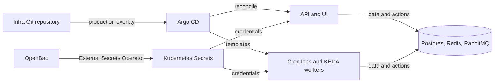

Argo CD deploys this repository's Kubernetes manifests. Start here to trace a release, understand access boundaries, or investigate a scheduled workload.

| You need to… | Read |
|---|---|
| Trace a merge and verify image digests | [Deployment](deployment.md) |
| Find ports, authentication boundaries and DNS ownership | [Networking](networking.md) |
| Back up, restore or inspect database access | [Databases](databases.md) |
| Look up every CronJob and its alert | [Schedules](schedules.md) |
| Recover a failed job, session, queue or release | [Operations](operations.md) |
| Understand how jobs start and why CronJobs are going away | [ADR 0001: Unified job launcher](adr/0001-unified-job-launcher.md) |
| Understand credential delivery and rotation | [Secrets](secrets.md) |

:::note[Repository boundary]
Shared controllers, public DNS, tunnel routing and telemetry services live in the cluster repository. This repository owns application workloads, stores, secret references, dashboards and alert definitions.
:::
