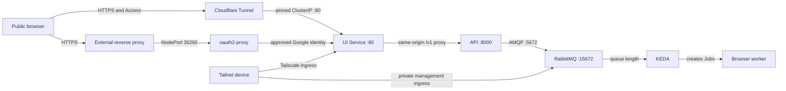

The UI has two authenticated public paths and a separate private Tailscale ingress. API and database Services stay inside the cluster; browser workers make outbound requests to ESPN.

## Find services and ports

All application resources use `default` unless specified otherwise.

| Service | Type | Port | Exposure and use |
|---|---|---|---|
| `fantasy-web-ui` | ClusterIP (pinned) | 80/TCP | UI and same-origin `/v1/*` proxy; reached through the access paths above |
| `oauth2-proxy` | NodePort | 4180/TCP; node port 30292 | External reverse proxy routes public UI traffic here |
| `fantasy-core-pipeline` | ClusterIP | 8000/TCP | Internal API; public UI requests reach it through UI nginx |
| `fantasy-db` | Headless | 5432/TCP | PostgreSQL/TimescaleDB, internal only |
| `fantasy-cache` | ClusterIP | 6379/TCP | Internal cache |
| `fantasy-broker` | ClusterIP | 5672 and 15672/TCP | Internal AMQP; management HTTP also has private Tailscale ingress |

Shared telemetry endpoints (Prometheus, Loki, Grafana and Tempo) and shared model services are owned by the cluster repository. There is no application API ingress directly exposing port 8000.

:::warning[Internal is a routing boundary]
This repository defines no NetworkPolicies. ClusterIP and headless Services do not enforce isolation between cluster workloads. Restrict node port access to the intended reverse proxy at the cluster/network boundary.
:::

## Understand each access path

| Path | Authentication boundary | Owner |
|---|---|---|
| Cloudflare Tunnel → UI | Cloudflare Access policy at the edge; bypasses oauth2-proxy | Cluster repository and Cloudflare configuration |
| Reverse proxy → oauth2-proxy → UI | Google OIDC, approved-email file and secure cookie | External proxy/TLS in cluster repo; OAuth proxy in this repo |
| Tailscale ingress → UI | Tailnet membership and access policy | Ingress in this repo; shared Tailscale operator |
| Tailscale ingress → broker management | Tailnet policy plus RabbitMQ login | Ingress in this repo; shared Tailscale operator |

`oauth2-proxy` fronts both the SPA and its proxied API. Keep its redirect URI, cookie domain, OAuth provider registration and public DNS aligned. Its `--reverse-proxy` setting trusts forwarded protocol headers from the upstream proxy that terminates TLS.

The redirect URI, cookie domain and approved-email file come from a required Secret managed by External Secrets Operator. Provision them using [private deployment values](deployment.md#supply-private-deployment-values). OAuth admission uses the file allow-list alone; `--email-domain` would also admit every account in that domain.

The tunnel connects directly to a pinned UI ClusterIP because its host-network deployment uses node DNS, not cluster DNS. Coordinate any UI Service address change with the tunnel route. Public domain examples should use `ui.example.com` and `draft.example.com`; tailnet examples should use `<private-ui>.<tailnet>.ts.net`.

## Trace DNS ownership

| Name class | Resolver/routing owner | Operator check |
|---|---|---|
| `service.default.svc.cluster.local` | Kubernetes cluster DNS | Service exists, endpoints are ready, workload DNS policy is correct |
| Public UI domain | Public DNS and Cloudflare tunnel or reverse-proxy route | DNS target, edge policy, TLS and backend route agree |
| Private ingress domain | Tailscale operator and tailnet DNS | Operator ingress status, device membership and tailnet policy |

Do not replace cluster Service names with public domains for internal traffic. Review the cluster repository for actual DNS records and ingress mappings; these docs intentionally omit deployment addresses.

## Trace queue scaling

Production polls RabbitMQ every 10 seconds, requests a worker per queued message and caps concurrent worker Jobs at three. Workers exit after 120 idle seconds; draft-day keeps at least one warm worker and sets idle exit to zero.

| KEDA trigger queues | Provisioning |
|---|---|
| `lineup_updates`, `waiver_actions`, `draft_targets` | Broker startup definitions; dead-letter policy to `dlx` and matching `.dlq` |
| `trade_submissions`, `trade_responses` | Broker startup definitions and worker declarations; no added DLQ policy |
| `trade_evaluations`, `trade_negotiations`, `llm_requests` | Worker declares durable queues; a fresh scaler can report missing queues before first worker startup |

KEDA reads broker credentials through a TriggerAuthentication; workers use a Secret-backed AMQP URL. Queue existence and authentication must succeed even when workers scale to zero.

Related: [Stuck queue runbook](operations.md#recover-a-stuck-queue), [Broker rollout](rabbitmq-queue-rollout.md), [Secrets](secrets.md).
