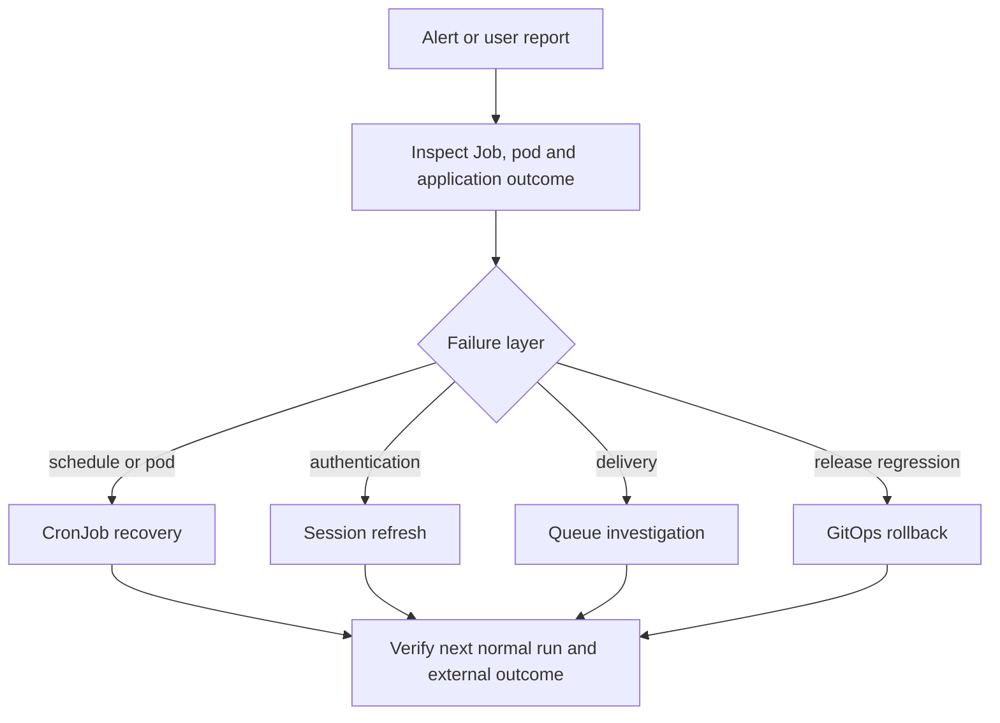

Use read-only evidence to identify the failing layer before retrying a workload. A completed Kubernetes Job proves process completion; it does not prove an ESPN action was applied.



| Detail runbook | Use it for |
|---|---|
| [CronJob alerts](cronjob-alerts.md) | Failure/missed-run semantics and per-job dependencies |
| [Schedule order and refresh horizon](cronjob-schedule-order.md) | Tuesday job ordering and the daily projection/VORP refresh |
| [Application outcomes and trade jobs](cronjob-application-outcomes.md) | Rumor-action outcome alert, trade scan and trade inbox |
| [RabbitMQ rollout](rabbitmq-queue-rollout.md) | Durable topology, storage migration gate and queue provisioning |
| [Unattended IR publication](auto-publish-ir-moves.md) | Shared OFF flag, rollout verification and rollback limitations |
| [Schedules](schedules.md) | Complete generated inventory and alert UIDs |

## Investigate a failed CronJob

1. Identify the newest owned Job and its pod; older retained failures may be irrelevant:

   ```bash
   kubectl get cronjobs -n default -o wide
   kubectl get jobs -n default --sort-by=.metadata.creationTimestamp
   kubectl describe job <job-name> -n default
   kubectl logs job/<job-name> -n default --all-containers
   ```

2. Inspect events and init-container logs if the main container never started. Check image pulls, missing Secrets, capacity, deadline, API/store reachability and the [job's dependencies](cronjob-alerts.md#what-each-job-depends-on).
3. For a missed run, inspect schedule, timezone, suspension, last schedule and controller events. A running Job needs deadline/runtime investigation even if the failed-Job alert is clear.
4. Fix the dependency and observe the next scheduled run. Confirm Job success, last-success advancement and application outcomes in Grafana/Loki.

:::warning[Retry can publish actions]
Do not create a replacement Job blindly. Check execution records, queue state and bot retry semantics first; rumor-action retries and outgoing trade claims require particular care. A zero-action success can be a healthy no-op.
:::

## Recover an expired ESPN session

1. Check the latest `espn-session-healthcheck` run (`kubectl logs -n default -l fantasy.job=espn-session-healthcheck --tail=200`) and application authentication errors. Separate ESPN/network outages from rejected or expired authentication.
2. Have the operator refresh the ESPN login using the worker's private login workflow. Update the cookie pair and, when used, browser storage state together through OpenBao; never attach them to an issue.
3. Verify ExternalSecret synchronization. Workers prefer stored browser state when present; a stale state file can matter even after the cookie pair changes.
4. Refresh affected consumers under the operator's maintenance plan and observe the next healthcheck or normal authenticated read. Existing environment variables and active Jobs retain their prior values; subPath-mounted state requires a new pod.

Verify authentication before resuming dependent publishers. Do not test a login by submitting a lineup, waiver or trade action.

## Recover a stuck queue

1. Inspect scaler conditions, worker Jobs and broker readiness:

   ```bash
   kubectl get scaledjob fantasy-browser-worker-scaler -n default -o yaml
   kubectl get pods -n default -l app=fantasy-browser-worker
   kubectl get jobs -n default --sort-by=.metadata.creationTimestamp
   kubectl logs deploy/fantasy-broker -n default -c render-definitions
   kubectl exec -n default deploy/fantasy-broker -c rabbitmq -- \
     rabbitmqctl list_queues -p / name messages_ready messages_unacknowledged consumers
   ```

2. Use counts, consumer status and sanitized logs to choose the next check:

   | Evidence | Check |
   |---|---|
   | Ready messages, no workers | KEDA trigger queue existence, authentication, scaler events and scheduling capacity |
   | Unacknowledged messages | Active worker logs, ESPN session and downstream timeouts; a delivery may still be in flight |
   | DLQ messages | Rejection reason and execution evidence; repair input before considering replay |
   | Broker NotReady | Definitions init container, credential consistency, PVC binding and resource limits |

3. Repair the dependency and observe ready/unacknowledged counts decrease with normal successful executions. Do not purge queues, reset storage, synthesize messages or replay DLQs as a diagnostic.

For a broker replacement or first persistent-storage rollout, use the [storage approval gate](rabbitmq-queue-rollout.md#operator-approval-gate). Preserve the PVC on rollback once it holds messages.

## Roll back a deploy

1. Identify the failing reconciled Git revision and running image IDs using [Deployment](deployment.md#verify-the-running-digest). Record the known-good digests and whether database migrations or queued actions occurred.
2. For an image regression, coordinate pausing Image Updater for the affected image in the owning Application configuration. Otherwise its tracking of `latest` can overwrite a reverted digest. Preserve the other Application annotations.
3. Prepare a reviewed Git revert or digest-pinning change in `overlays/production`. Check both overlay renders and runtime Job image replacements. Keep compatible schema changes and persistent-store mounts; an image rollback does not reverse migrations.
4. Merge the recovery change and let Argo CD reconcile it. Its self-heal can undo direct cluster edits; changing live state alone is not a durable rollback.
5. Verify synced revision, ready replicas, pod image IDs and newly created Job templates. Inspect older active Jobs separately and validate normal application reads/outcomes before resuming publishers.
6. Restore updater tracking only when the published `latest` image is safe again, then verify the next write-back.

:::warning[External effects survive rollback]
Rollback does not cancel queued actions or undo ESPN moves. Keep `AUTO_PUBLISH_IR_MOVES` off unless separately approved; follow the [IR rollback checks](auto-publish-ir-moves.md#roll-back) for active publisher pods.
:::
