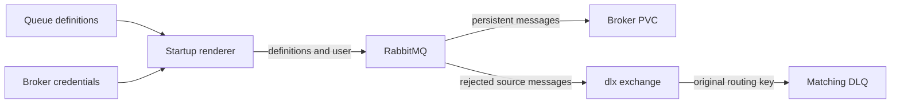

Use this page to check how the broker owns its queue topology, to migrate an older ephemeral broker to persistent storage, and to provision the trade queues.

## How are the queues defined?

The broker owns the durable topology for `lineup_updates`, `waiver_actions` and `draft_targets`. It also predeclares durable `trade_submissions` and `trade_responses` with empty arguments for the trade consumers.



| Queue | Declared by | Dead-letter handling |
|---|---|---|
| `lineup_updates`, `waiver_actions`, `draft_targets` | Broker definitions. Producers and consumers check the queue exists without redeclaring its arguments. | A broker policy sends rejected messages to the `dlx` exchange. The queue's original routing key selects its matching `.dlq`. |
| `trade_submissions`, `trade_responses` | Broker startup definitions, also asserted durable by the worker. Arguments stay empty. | None. They don't join the dead-letter policy or gain DLQs. |

:::note[Hardcoded arguments win]
Existing queues with hardcoded dead-letter arguments keep using those arguments, because RabbitMQ gives them precedence over a regular policy.
:::

## Operator approval gate

:::warning[First persistent-storage migration]
This gate is a maintenance procedure for an older ephemeral deployment, not a routine queue-definition update. Keep persistent storage mounted on subsequent rollouts.
:::

Merging the infra PR can trigger Argo CD to replace the RabbitMQ pod. This gate applies when migrating an older broker without a data volume. The current manifest mounts a 2 Gi `fantasy-broker-data` PVC and uses `Recreate`, so verify the deployed pod before deciding whether a migration is needed.

Replacing an older ephemeral broker can discard every message still in it. **Don't merge or sync the infra PR until the operator approves this gate.** Never reuse an earlier empty-queue observation as evidence for a new rollout.

1. Pause all AMQP publishers and consumers, including the core API, producer CronJobs and browser-worker Jobs. Wait for active Jobs and deliveries to finish, and keep everything paused through the broker replacement.
2. Run the first command below twice, at least one minute apart. Include every queue returned, including any `.dlq`. Every `messages_ready` and `messages_unacknowledged` value must be zero.
3. If any value is nonzero, **stop the rollout and leave the current pod running**. Drain or transfer those messages under a separate operator-approved procedure, then repeat this gate. Don't delete queues or reset broker data.
4. Approve the infra merge and Argo CD sync. Its `Recreate` strategy starts one broker against the new `fantasy-broker-data` PVC, with a stable Erlang node hostname. Wait for the PVC to bind and the pod to become ready.
5. Verify the policy, source queues, DLQs, exchange bindings and PVC are present.
6. Resume consumers, then publishers.

If verification fails, keep publishers paused. Any rollback must continue mounting the PVC once it contains messages.

### Verify

```bash
kubectl exec -n default deploy/fantasy-broker -c rabbitmq -- \
  rabbitmqctl list_queues -p / name messages_ready messages_unacknowledged
kubectl get pvc fantasy-broker-data -n default
kubectl exec -n default deploy/fantasy-broker -c rabbitmq -- \
  rabbitmqctl list_policies -p /
kubectl exec -n default deploy/fantasy-broker -c rabbitmq -- \
  rabbitmqctl list_bindings -p / source_name destination_name routing_key
```

<details>
<summary>Local broker contract test</summary>

The integration test uses disposable Docker brokers and the real Python producer and Node consumer. It covers a fresh definitions import, and existing queues both with and without hardcoded dead-letter arguments. Each existing queue carries a persistent message before policy import.

From this repo, run it after installing the sibling repos' dependencies:

```bash
FANTASY_CORE_ROOT=/path/to/fantasy-core-pipeline \
FANTASY_WORKER_ROOT=/path/to/fantasy-browser-worker \
  /path/to/fantasy-core-pipeline/.venv/bin/python tests/broker_contract.py
```

The test starts and stops its own containers. It never connects to the live broker.

</details>

## Broker user startup check

`RABBITMQ_DEFAULT_USER`/`_PASS` don't create a user on this image once `management.load_definitions` is active (#77). The `render-definitions` initContainer creates it instead.

The broker's startup and readiness probes run `rabbitmqctl authenticate_user` with the secret's credentials. If the user is missing or its password has drifted, the pod stays `NotReady` instead of silently refusing connections.

## Trade queue provisioning

KEDA watches `trade_submissions` and `trade_responses`.

:::info[Definitions load only at boot]
Updating the definitions ConfigMap doesn't import definitions into a running broker. Its rendered file and configuration are mounted with subPath and loaded at boot, and this change doesn't force a restart.
:::

| Broker state | What happens |
|---|---|
| Existing broker | The next ordinary worker startup declares the queues. Other KEDA triggers keep working meanwhile. |
| Fresh broker | Declares the queues before workers start. |
| Queue still absent | The operator decides when to restart a worker or broker. Don't publish a synthetic message or restart production resources to establish it. |

After sync, inspect the ScaledJob's trigger names and status read-only:

```bash
kubectl get scaledjob fantasy-browser-worker-scaler -n default -o yaml
```

Confirm both queues exist using the broker's read-only management queue inventory or existing telemetry.

:::danger[No test trade responses]
An empty or absent queue isn't a reason to enqueue a test trade response. Keep `TRADE_RESPONSE_ENABLED` unset and `DRY_RUN` at its safe unset default (true). Adding a scaler trigger authorizes no response.
:::
