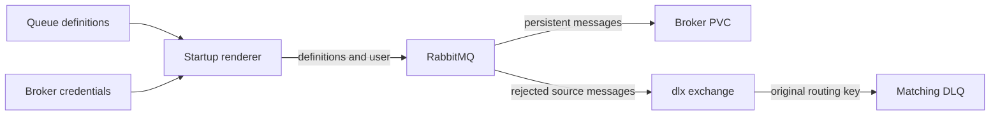

The broker owns the durable topology for `lineup_updates`, `waiver_actions`, and
`draft_targets`, and predeclares durable `trade_submissions` and `trade_responses`
with empty arguments for the trade consumers. Producers and consumers check that
the first three queues exist without redeclaring their arguments. A broker policy
sends their rejected messages to the existing `dlx` exchange; each queue's original
routing key selects its matching
`.dlq`. Existing queues with hardcoded dead-letter arguments continue to use
those arguments because RabbitMQ gives them precedence over a regular policy.



## Operator approval gate

:::warning[First persistent-storage migration]
This gate is a maintenance procedure for an older ephemeral deployment, not a routine queue-definition update. Keep persistent storage mounted on subsequent rollouts.
:::

Merging the infra PR can trigger Argo CD to replace the RabbitMQ pod. This gate applies when migrating an older broker without a data volume.
The current manifest mounts a 2 Gi `fantasy-broker-data` PVC and uses `Recreate`;
verify the deployed pod before deciding whether a migration is needed. A
replacement of an older ephemeral broker can discard every message still in it. **Do not merge or sync the infra PR until the operator approves
this gate.** Never reuse an earlier empty-queue observation as evidence for a new rollout.

1. Pause all AMQP publishers and consumers, including the core API, producer
   CronJobs, and browser-worker Jobs. Wait for active Jobs and deliveries to
   finish. Keep them paused through the broker replacement.
2. Run the command below twice, at least one minute apart. Include every queue
   returned, including any `.dlq`. Every `messages_ready` and
   `messages_unacknowledged` value must be zero. If any value is nonzero,
   **stop the rollout and leave the current pod running**. Drain or transfer
   those messages under a separate operator-approved procedure, then repeat
   this gate. Do not delete queues or reset broker data.
3. Approve the infra merge and Argo CD sync. Its `Recreate` strategy starts
   one broker against the new `fantasy-broker-data` PVC, with a stable Erlang
   node hostname. Wait for the PVC to bind and the pod to become ready.
4. Verify that the policy, source queues, DLQs, exchange bindings, and PVC are
   present. Resume consumers, then publishers. If verification fails, keep
   publishers paused; any rollback must continue mounting the PVC once it
   contains messages.

```bash
kubectl exec -n default deploy/fantasy-broker -c rabbitmq -- \
  rabbitmqctl list_queues -p / name messages_ready messages_unacknowledged
kubectl get pvc fantasy-broker-data -n default
kubectl exec -n default deploy/fantasy-broker -c rabbitmq -- \
  rabbitmqctl list_policies -p /
kubectl exec -n default deploy/fantasy-broker -c rabbitmq -- \
  rabbitmqctl list_bindings -p / source_name destination_name routing_key
```

The local integration test uses disposable Docker brokers and the real Python
producer and Node consumer. It covers a fresh definitions import and existing
queues both with and without hardcoded dead-letter arguments, each carrying a
persistent message before policy import. From this repo,
run it after installing the sibling repos' dependencies:

```bash
FANTASY_CORE_ROOT=/path/to/fantasy-core-pipeline \
FANTASY_WORKER_ROOT=/path/to/fantasy-browser-worker \
  /path/to/fantasy-core-pipeline/.venv/bin/python tests/broker_contract.py
```

The test starts and stops its own containers. It never connects to the live
broker.

## Broker user startup check

`RABBITMQ_DEFAULT_USER`/`_PASS` do not create a user on this image once
`management.load_definitions` is active (#77). The `render-definitions`
initContainer creates it, and the broker's startup and readiness probes run
`rabbitmqctl authenticate_user` with the secret's credentials. If the user is
missing or its password has drifted, the pod stays `NotReady` instead of
silently refusing connections.

## Trade queue provisioning

KEDA watches `trade_submissions` and `trade_responses`. Both are predeclared in
broker startup definitions and are also asserted durable by the worker. Their
arguments stay empty, matching the worker declaration; they do not join the
existing dead-letter policy or gain new DLQs.

Updating the definitions ConfigMap does not import definitions into a running
broker: its rendered file and configuration are mounted with subPath and loaded
at boot. This change does not force a broker restart. On an existing broker the
next ordinary worker startup declares these queues; other KEDA triggers continue
working meanwhile. A fresh broker declares them before workers start. If a queue
remains absent, let the operator decide when to restart a worker or broker; do not
publish a synthetic message or restart production resources to establish it.

After sync, inspect the ScaledJob's trigger names and status/conditions read-only
with `kubectl get scaledjob fantasy-browser-worker-scaler -n default -o yaml`.
Confirm both queues exist using the broker's read-only management queue inventory
or existing telemetry. An empty or absent queue is not a reason to enqueue a test
trade response. Keep `TRADE_RESPONSE_ENABLED` unset and `DRY_RUN` at its safe
unset default (true). No response is authorized by adding a scaler trigger.
