Catalog schedules and dependency chains are generated from `base/launcher/catalog.yaml`. During cutover, the inventory also includes CronJobs rendered from the production overlay and their committed Grafana alert selectors. Draft-day inherits the same CronJob schedules.

:::note[Timezones and alerts]
An unset `spec.timeZone` uses the controller's timezone; this deployment uses UTC for the ESPN healthcheck. America/Chicago jobs follow daylight saving time. Missed-run grace measures Job creation, not completion.
:::

<!-- BEGIN GENERATED SCHEDULES -->
### Catalog jobs
| Job | Schedule | Command |
|---|---|---|
| `espn-session-healthcheck` | `0 6 * * 1` (UTC) | `node src/bots/check_espn_session.js` |
| `lineup-optimizer` | — | `python -m src.optimization.lineup_solver` |
| `metrics-extractor` | — | `python -m src.ingestion.metrics_extractor` |
| `projections-refresh` | `0 18 * * *` (America/Chicago) | `python -m src.jobs.draft_prep_refresh` |
| `rapid-status-syncer` | `*/10 * * * 4,0,1` (America/Chicago) | `python -m src.ingestion.sync_players` |
| `rumor-action-trigger` | `45 21 * * *` (America/Chicago) | `python -m src.services.rumor_action_service --team-id $(ESPN_TEAM_ID) --season $(CURRENT_YEAR)` |
| `rumor-digest-bot` | `0 11 * * *` (America/Chicago) | `node src/bots/rumor_digest_bot.js` |
| `rumor-syncer` | `*/30 * * * *` (America/Chicago) | `python -m src.ingestion.sync_rumors` |
| `stale-draft-job-sweeper` | `*/15 * * * *` (America/Chicago) | `python -m src.ops.sweep_stale_draft_jobs` |
| `sync-actual-scores` | `0 10 * * 5` (America/Chicago) | `python -m src.ingestion.sync_actual_scores --season $(CURRENT_YEAR)` |
| `sync-league` | — | `python -m src.ingestion.sync_league --season $(CURRENT_YEAR)` |
| `trade-candidates` | `0 7 * * *` (America/Chicago)<br/>`30 12 * * 3,5` (America/Chicago) | `python -m src.jobs.trade_candidates` |
| `trade-inbox` | `0 8-22/2 * * *` (America/Chicago) | `node src/bots/trade_inbox.js --refresh` |
| `trade-scan` | `0 13 * * 3,5` (America/Chicago) | `node src/bots/trade_scan.js --stage` |
| `waiver-trigger` | — | `python -m src.optimization.waiver_evaluator` |

## tuesday-weekly

Schedule: `0 16 * * 2` (America/Chicago)

```mermaid
flowchart LR
    sync-league["sync-league"]
    metrics-extractor["metrics-extractor"]
    sync-actual-scores["sync-actual-scores"]
    projections-refresh["projections-refresh"]
    lineup-optimizer["lineup-optimizer (latest 19:15)"]
    waiver-trigger["waiver-trigger (latest 20:30)"]
    rumor-action-trigger["rumor-action-trigger (latest 21:45)"]
    sync-league -->|success| metrics-extractor
    metrics-extractor -->|success| sync-actual-scores
    sync-actual-scores -->|finish| projections-refresh
    projections-refresh -->|finish| lineup-optimizer
    lineup-optimizer -->|finish| waiver-trigger
    waiver-trigger -->|finish| rumor-action-trigger
```



### Legacy CronJobs
| CronJob | Cron expression | Timezone | What runs | Alerts |
|---|---|---|---|---|
| `espn-session-healthcheck` | `0 6 * * 1` | Unset (controller timezone; UTC in this deployment) | `src/bots/check_espn_session.js` | Latest Job failed (`fantasy-cronjob-job-failed`)<br/>Missed > 120m (`fantasy-cronjob-missed-schedule`) |
| `fantasy-draft-prep-refresher` | `0 18 * * *` | America/Chicago | Projection → K/D-ST → VORP supervisor (up to four weeks) | Latest Job failed (`fantasy-cronjob-job-failed`)<br/>Missed > 120m (`fantasy-cronjob-missed-schedule`) |
| `fantasy-lineup-optimizer` | `15 19 * * 2` | America/Chicago | `src.optimization.lineup_solver` | Latest Job failed (`fantasy-cronjob-job-failed`)<br/>Missed > 120m (`fantasy-cronjob-missed-schedule`) |
| `fantasy-rapid-status-syncer` | `*/10 * * * 4,0,1` | America/Chicago | `src.ingestion.sync_players` | Latest Job failed (`fantasy-cronjob-job-failed`)<br/>Missed > 20m (`fantasy-cronjob-missed-schedule-rapid`) |
| `fantasy-rumor-action-trigger` | `45 21 * * *` | America/Chicago | `src.services.rumor_action_service` | Latest Job failed (`fantasy-cronjob-job-failed`)<br/>Missed > 120m (`fantasy-cronjob-missed-schedule`) |
| `fantasy-rumor-syncer` | `*/30 * * * *` | America/Chicago | `src.ingestion.sync_rumors` | Latest Job failed (`fantasy-cronjob-job-failed`)<br/>Missed > 60m (`fantasy-cronjob-missed-schedule-rumor`) |
| `fantasy-stale-draft-job-sweeper` | `*/15 * * * *` | America/Chicago | `src.ops.sweep_stale_draft_jobs` | Latest Job failed (`fantasy-cronjob-job-failed`)<br/>Missed > 30m (`fantasy-cronjob-missed-schedule-sweeper`) |
| `fantasy-sync-actual-scores` | `5 17 * * 2` | America/Chicago | `src.ingestion.sync_actual_scores` | Latest Job failed (`fantasy-cronjob-job-failed`)<br/>Missed > 120m (`fantasy-cronjob-missed-schedule`) |
| `fantasy-sync-actual-scores-reconcile` | `0 10 * * 5` | America/Chicago | `src.ingestion.sync_actual_scores` | Latest Job failed (`fantasy-cronjob-job-failed`)<br/>Missed > 120m (`fantasy-cronjob-missed-schedule`) |
| `fantasy-trade-candidates` | `0 7 * * *` | America/Chicago | `src.jobs.trade_candidates` | Latest Job failed (`fantasy-cronjob-job-failed`)<br/>Missed > 120m (`fantasy-cronjob-missed-schedule`) |
| `fantasy-trade-candidates-prescan` | `30 12 * * 3,5` | America/Chicago | `src.jobs.trade_candidates` | Latest Job failed (`fantasy-cronjob-job-failed`)<br/>Missed > 120m (`fantasy-cronjob-missed-schedule`) |
| `fantasy-weekly-ingestor` | `0 16 * * 2` | America/Chicago | `src.ingestion.sync_league` → `src.ingestion.metrics_extractor` | Latest Job failed (`fantasy-cronjob-job-failed`)<br/>Missed > 120m (`fantasy-cronjob-missed-schedule`) |
| `fantasy-weekly-waiver-trigger` | `30 20 * * 2` | America/Chicago | `src.optimization.waiver_evaluator` (resolves upcoming week) | Latest Job failed (`fantasy-cronjob-job-failed`)<br/>Missed > 120m (`fantasy-cronjob-missed-schedule`) |
| `rumor-digest-bot` | `0 11 * * *` | America/Chicago | `src/bots/rumor_digest_bot.js` | Latest Job failed (`fantasy-cronjob-job-failed`)<br/>Missed > 120m (`fantasy-cronjob-missed-schedule`) |
| `trade-inbox` | `0 8-22/2 * * *` | America/Chicago | `src/bots/trade_inbox.js --refresh` | Latest Job failed (`fantasy-cronjob-job-failed`)<br/>Missed > 120m (`fantasy-cronjob-missed-schedule`) |
| `trade-scan` | `0 13 * * 3,5` | America/Chicago | `src/bots/trade_scan.js --stage` | Latest Job failed (`fantasy-cronjob-job-failed`)<br/>Missed > 120m (`fantasy-cronjob-missed-schedule`) |
<!-- END GENERATED SCHEDULES -->

## Refresh the inventory

With `kubectl` and Python's PyYAML installed, run from the repository root:

```bash
python3 scripts/generate-schedules.py
python3 scripts/generate-schedules.py --check
```

After CronJob cutover, add `--catalog-only` to both commands so generation no longer reads the rendered manifests or alert rules.

The `Docs schedules` workflow checks this section on documentation, catalog, manifest and alert changes. CronJobs represented by catalog jobs do not need legacy failed-Job and missed-schedule alerts; other legacy CronJobs must keep both. Chain edges show whether a step waits for its predecessor to succeed or finish, and latest times are shown on the relevant steps.

The catalog chain diagram describes dependency enforcement. Other cron expressions remain independent schedules; clock order alone does not imply that one job waits for another.

Related: [CronJob alert semantics and dependencies](cronjob-alerts.md), [Failed CronJob runbook](operations.md#investigate-a-failed-cronjob).
