Catalog schedules and dependency chains are generated from `base/launcher/catalog.yaml`. Don't edit the table by hand: run `python3 scripts/generate-schedules.py`. A job with no schedule runs only as a chain step or on request.

:::note[Timezones and alerts]
America/Chicago jobs follow daylight saving time, so their UTC time shifts twice a year. For alerts, see [Job alerts](cronjob-alerts.md).
:::

<!-- BEGIN GENERATED SCHEDULES -->
### Catalog jobs
| Job | Schedule | Command |
|---|---|---|
| `espn-session-healthcheck` | `0 6 * * 1` (UTC) | `node src/bots/check_espn_session.js` |
| `lineup-optimizer` | — | `python -m src.optimization.lineup_solver` |
| `metrics-extractor` | — | `python -m src.ingestion.metrics_extractor` |
| `projections-refresh` | `0 18 * * *` (America/Chicago) | `python -m src.jobs.draft_prep_refresh` |
| `rapid-status-syncer` | `*/10 * * * 4,0,1` (America/Chicago) | `python -m src.ingestion.sync_players` |
| `rumor-action-trigger` | `45 21 * * *` (America/Chicago) | `python -m src.services.rumor_action_service --team-id $(ESPN_TEAM_ID) --season $(CURRENT_YEAR)` |
| `rumor-digest-bot` | `0 11 * * *` (America/Chicago) | `node src/bots/rumor_digest_bot.js` |
| `rumor-syncer` | `*/30 * * * *` (America/Chicago) | `python -m src.ingestion.sync_rumors` |
| `stale-draft-job-sweeper` | `*/15 * * * *` (America/Chicago) | `python -m src.ops.sweep_stale_draft_jobs` |
| `sync-actual-scores` | `0 10 * * 5` (America/Chicago) | `python -m src.ingestion.sync_actual_scores --season $(CURRENT_YEAR)` |
| `sync-league` | — | `python -m src.ingestion.sync_league --season $(CURRENT_YEAR)` |
| `trade-candidates` | `0 7 * * *` (America/Chicago)<br/>`30 12 * * 3,5` (America/Chicago) | `python -m src.jobs.trade_candidates` |
| `trade-inbox` | `0 8-22/2 * * *` (America/Chicago) | `node src/bots/trade_inbox.js --refresh` |
| `trade-scan` | `0 13 * * 3,5` (America/Chicago) | `node src/bots/trade_scan.js --stage` |
| `waiver-trigger` | — | `python -m src.optimization.waiver_evaluator` |

### Chain: tuesday-weekly

Schedule: `0 16 * * 2` (America/Chicago)

```mermaid
flowchart LR
    sync-league["sync-league"]
    metrics-extractor["metrics-extractor"]
    sync-actual-scores["sync-actual-scores"]
    projections-refresh["projections-refresh"]
    lineup-optimizer["lineup-optimizer (latest 19:15)"]
    waiver-trigger["waiver-trigger (latest 20:30)"]
    rumor-action-trigger["rumor-action-trigger (latest 21:45)"]
    sync-league -->|success| metrics-extractor
    metrics-extractor -->|success| sync-actual-scores
    sync-actual-scores -->|finish| projections-refresh
    projections-refresh -->|finish| lineup-optimizer
    lineup-optimizer -->|finish| waiver-trigger
    waiver-trigger -->|finish| rumor-action-trigger
```


<!-- END GENERATED SCHEDULES -->

## Refresh the inventory

With `kubectl` and Python's PyYAML installed, run from the repository root:

```bash
python3 scripts/generate-schedules.py
python3 scripts/generate-schedules.py --check
```

The `Docs schedules` workflow checks this section on documentation, catalog and manifest changes. Chain edges show whether a step waits for its predecessor to succeed or finish, and latest times are shown on the relevant steps.

## Read the weekly order

The `tuesday-weekly` chain above orders Tuesday's jobs by dependency; see [schedule order](cronjob-schedule-order.md). The other jobs are spaced by the clock. Friday's 10:00 actual-score reconciliation precedes the 12:30 trade candidates and the 13:00 trade scan. The daily 11:00 rumor digest precedes the 21:45 action trigger. These are clock offsets, not dependency enforcement: a failed or delayed producer still needs investigation.

Related: [Job alert semantics and dependencies](cronjob-alerts.md), [failed job runbook](operations.md#investigate-a-failed-job).
