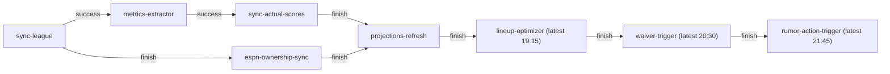

Catalog schedules and dependency chains are generated from `charts/fantasy/files/catalog.yaml`. Don't edit the table by hand: run `python3 scripts/generate-schedules.py`. Event subscriptions are listed with the schedules. A job with neither runs only as a chain step or on request.

:::note[Timezones and alerts]
America/Chicago jobs follow daylight saving time, so their UTC time shifts twice a year. For alerts, see [Job alerts](cronjob-alerts.md).
:::

<!-- BEGIN GENERATED SCHEDULES -->
### Catalog jobs
| Job | Schedule | Command |
|---|---|---|
| `draft-connector` | — | `node src/bots/draft_sync.js` |
| `draft-listener` | — | `python -m src.optimization.draft_matrix` |
| `espn-ownership-sync` | `45 17 * * *` (America/Chicago) | `python -m src.ingestion.sync_espn_ownership` |
| `espn-session-healthcheck` | `0 6 * * 1` (UTC) | `node src/bots/check_espn_session.js` |
| `lineup-optimizer` | — | `python -m src.optimization.lineup_solver` |
| `live-games` | `30 18 * * 4` (America/Chicago)<br/>`30 10 * 11 4` (America/Chicago)<br/>`0 15 * 11 4` (America/Chicago)<br/>`30 8,15 * * 0` (America/Chicago)<br/>`30 17 * * 1` (America/Chicago) | `python -m src.ingestion.live_games` |
| `metrics-extractor` | — | `python -m src.ingestion.metrics_extractor` |
| `practice-draft-connector` | — | `node src/bots/draft_sync.js` |
| `practice-draft-listener` | — | `python -m src.optimization.draft_matrix` |
| `projections-refresh` | `0 18 * * *` (America/Chicago) | `python -m src.jobs.draft_prep_refresh` |
| `rapid-status-syncer` | `*/10 * * * 4,0,1` (America/Chicago) | `python -m src.ingestion.sync_players` |
| `rumor-action-trigger` | `45 21 * * *` (America/Chicago)<br/>on `rumor.signal_created` (debounce 30m) | `python -m src.services.rumor_action_service --team-id $(ESPN_TEAM_ID) --season $(CURRENT_YEAR)` |
| `rumor-digest-bot` | `0 11 * * *` (America/Chicago) | `node src/bots/rumor_digest_bot.js` |
| `rumor-syncer` | `*/30 * * * *` (America/Chicago) | `python -m src.ingestion.sync_rumors` |
| `sync-actual-scores` | `0 10 * * 5` (America/Chicago) | `python -m src.ingestion.sync_actual_scores --season $(CURRENT_YEAR)` |
| `sync-league` | — | `python -m src.ingestion.sync_league --season $(CURRENT_YEAR)` |
| `trade-candidates` | `0 7 * * *` (America/Chicago)<br/>`30 12 * * 3,5` (America/Chicago) | `python -m src.jobs.trade_candidates` |
| `trade-inbox` | `0 8-22/2 * * *` (America/Chicago) | `node src/bots/trade_inbox.js --refresh` |
| `trade-scan` | `0 13 * * 3,5` (America/Chicago) | `node src/bots/trade_scan.js --stage` |
| `trade-submit` | — | `node src/bots/trade_builder.js` |
| `waiver-trigger` | — | `python -m src.optimization.waiver_evaluator` |

### Chain: tuesday-weekly

Schedule: `0 16 * * 2` (America/Chicago)


<!-- END GENERATED SCHEDULES -->

## Refresh the inventory

With `kubectl` and Python's PyYAML installed, run from the repository root:

```bash
python3 scripts/generate-schedules.py
python3 scripts/generate-schedules.py --check
```

The `Docs schedules` workflow checks this section on documentation, catalog and manifest changes. Chain edges show whether a step waits for its predecessor to succeed or finish, and latest times are shown on the relevant steps.

## Read the weekly order

The `tuesday-weekly` chain above orders Tuesday's jobs by dependency; see [schedule order](cronjob-schedule-order.md). The other jobs are spaced by the clock. Friday's 10:00 actual-score reconciliation precedes the 12:30 trade candidates and the 13:00 trade scan. The daily 11:00 rumor digest emits `rumor.signal_created` for each signal it stores, and the first event in each 30-minute window starts `rumor-action-trigger`, so rumor actions follow the digest within minutes. Signals that need fresh VORP are held for the 21:45 run (on Tuesday, the chain's last step), which also covers any event the digest failed to emit, since emission has no outbox. The other offsets are clock spacing, not dependency enforcement: a failed or delayed producer still needs investigation.

Related: [Job alert semantics and dependencies](cronjob-alerts.md), [failed job runbook](operations.md#investigate-a-failed-job).
