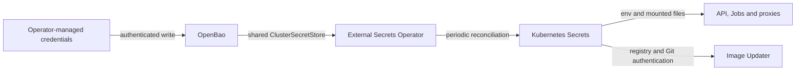

OpenBao holds credentials; External Secrets Operator materializes Kubernetes Secrets from ExternalSecret definitions. Workloads consume Secret references rather than committed values.



## Know the credential groups

| Group | Consumers |
|---|---|
| Postgres writer and reader | API/Jobs; read-only role provisioning and Grafana |
| RabbitMQ | Producers, consumers, broker startup rendering and KEDA |
| ESPN cookie pair and optional browser state | API ingestion, session healthcheck and browser workloads |
| Trigger API key | UI's API proxy and scheduled action callers |
| LLM provider credentials | Relevant digest and model consumers |
| OAuth client and cookie credentials | oauth2-proxy |
| Registry pull and Git write-back credentials | Private image pulls and Image Updater |

The production overlay owns ExternalSecret definitions, including a separate updater resource in `argocd`. The shared store and operator authentication policy belong to the cluster repository. These docs intentionally omit provider paths, values and tokens.

## Verify delivery

```bash
kubectl get externalsecrets -n default
kubectl get externalsecrets -n argocd
kubectl get clustersecretstore openbao
kubectl get events -n default --sort-by=.metadata.creationTimestamp
```

Inspect Ready/synchronization status and sanitized error reasons. Do not dump Secret YAML, decoded values, cookies, browser state or environment variables into tickets or public logs.

| Symptom | Check |
|---|---|
| ExternalSecret not Ready | Store readiness, operator authentication/permissions and expected source fields |
| Pod cannot start | Required Secret exists in the pod's namespace and referenced key is present |
| Credential changed but process uses old value | Pod creation time and delivery method; environment variables only refresh in new pods |
| Broker rejects credentials | Startup renderer/probes and producer/consumer rollout order |

## Rotate credentials

1. Replace the credential at its issuer and update OpenBao through the approved private operator workflow.
2. Wait for ExternalSecret synchronization; verify status without printing the Secret.
3. Coordinate consumer refresh. New CronJob pods read new environment values; existing pods retain old ones. Mounted files depend on refresh behavior, and subPath mounts do not receive updates.
4. Verify authentication using normal read-only traffic. Database initialization variables do not rotate an existing PostgreSQL role; coordinate database-role changes separately.

Broker definitions load at startup, and the read-only database provisioning Job needs a new execution after a reader-password change. Plan these with [Operations](operations.md) and [Databases](databases.md) rather than assuming a Secret update restarts everything.
